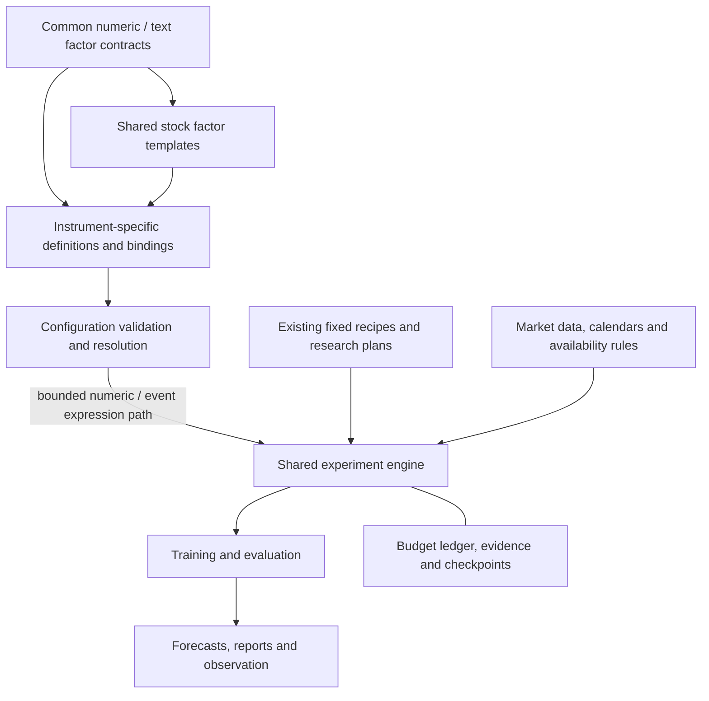
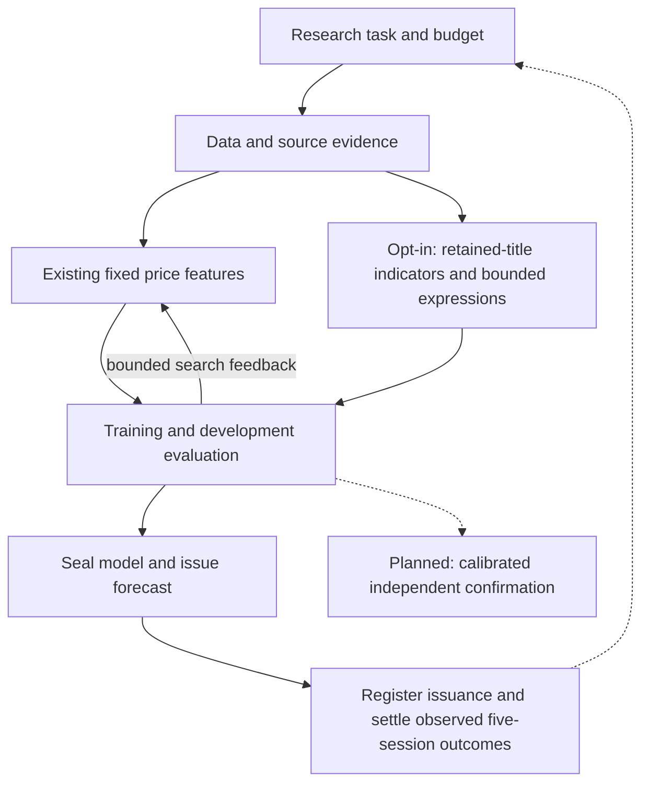

# Quant RSI

**A framework for reproducible factor research and forecasting experiments.**

Quant RSI separates a shared research engine, reusable factor definitions and
instrument-specific configuration. It preserves data evidence, experiment budgets
and results so that research can be inspected, resumed and replayed.

RSI means **recursive self-improvement** here. The long-term goal is to test whether
feedback can improve factors and research strategies under a fixed budget. Today,
the system runs fixed-model forecasts and bounded searches; general factor-tree
execution, live news discovery and complete recursive self-improvement are still
under development. Predictive advantage has not been established.

[Quick start](#installation-and-usage) · [Capabilities](#current-capabilities) ·
[Guides](#documentation) · [Roadmap](#roadmap) · [Contributing](#development-and-validation)

## Architecture

Shared definitions live outside individual stocks. Each stock selects shared
templates and owns its source bindings, local hypotheses and factor relationships.



Validation alone does not make a definition a model input. The opt-in
[factor discovery path](docs/factor_discovery.md) executes selected numeric bindings
and registered event indicators; general text tasks and factor trees remain specifications.
Existing forecasts retain their registered recipes.
CALM's egg-price relationships belong to its own configuration; KO can reuse the
same stock-price template without inheriting CALM's business assumptions.
See [factor ownership and types](docs/factor_layers.md).

| Location | Responsibility |
| --- | --- |
| `src/quant_rsi/` | Shared data, factor contracts, research, forecast, evaluation and execution code |
| `instruments/shared/` | Reusable stock factor templates |
| `instruments/<MARKET>/<SYMBOL>/` | Instrument profiles, factor bindings and local relationships |
| [`experimental/candidate_factors/`](experimental/candidate_factors/README.md) | Source-pinned open-source factor survey, licenses and integration examples; not runtime registrations |
| `examples/` and `tests/` | Runnable plans, small fixtures and offline regression tests |
| `docs/` | Operating guides, design specifications and experiment reports |
| `data/`, `runs/`, `.quant_rsi/` | Ignored local data, outputs and authoritative workspace state |

## Research workflow

The intended workflow connects an information need to evidence, factors,
experiments and feedback. The implemented paths cover only part of this chain.



Solid arrows show existing paths; dashed arrows show integrations still to build.
Forecast publication does not imply independent confirmation or production
promotion. The [forecast observation ledger](docs/forecast_observations.md) links
confirmed issuance to later market receipts and preserves outcome revisions.
Feeding those outcomes into subsequent research decisions remains to be built.

## Current capabilities

| Capability | Status and boundary |
| --- | --- |
| Five-session price forecasting | Available for explicitly supported sources/markets; includes collection, fixed-model research, model sealing and replay |
| Prospective forecast observation | Offline registration and append-only outcome settlement from observed market receipts; real prospective accumulation and outcome-driven policy updates remain outstanding |
| Enhanced forecast comparison | Available: three predefined price/context recipes, frozen folds, naive controls and a separate publication fit |
| Bounded factor research | Available: momentum/mean-return neighbor search and limited, registered research-program changes |
| Shared and instrument-specific factors | Numeric bindings can enter bounded discovery; general text definitions remain specifications |
| Automatic factor discovery | Finite multi-leaf compositions, feedback-dependent exploration and common multi-fold comparisons; no general proposer-program evolution |
| Candidate factor execution | Opt-in [Qlib ROC and MA close-price adapters](docs/candidate_factor_runtime.md) feed bounded discovery; the remaining survey candidates are not executable |
| Dynamic event factors | Registered title instances, observed lifecycle transitions, decay and archival; KO RSS observations can enter this path |
| Multi-branch factor discovery | CALM is a worked specification; its factor tree is not executable |
| News and financial evidence | Retained KO title indicators can enter opt-in comparisons/discovery; other evidence remains sidecar-only |
| News collection and extraction | [Bounded KO official RSS observations](docs/news_collection.md), retained-title extraction and revision tracking; provider-side search/full-text extraction remain open in [RFC #28](https://github.com/natureofnature/Quant_RSI/issues/28) |
| Statistical confirmation and promotion | Incomplete; protected evaluation is engineering-only and retains the incumbent |
| Live trading and general self-modification | Not implemented |

Older guides use project-local labels: **M0** is fixed-model execution, **C2** is
the factor research loop, **C4** is a research-program paired experiment, and
**C5** is protected evaluation. These are not standard quant/AI terms.

## Installation and Usage

Use **Linux and Python 3.12**. Process control uses POSIX locks, signals and resource
limits; Windows is not supported. Dependency installation needs network access.
Run from a fresh clone:

```bash
git clone https://github.com/natureofnature/Quant_RSI.git
cd Quant_RSI
python3.12 -m venv .venv
source .venv/bin/activate
python -m pip install -r requirements-dev.lock
python -m pip install --no-deps -e .
```

Run the synthetic demonstration without external data services:

```bash
quant-rsi run examples/development.json --output runs/demo
quant-rsi status runs/demo
quant-rsi replay runs/demo
quant-rsi resume runs/demo
```

Expect two completed candidates and one deliberately rejected future-shift
candidate. `run` needs a new directory; use `resume` for an initialized experiment.
Commands return JSON: exit code zero can include candidate failures or budget
exhaustion, so inspect `execution_status` and candidate statuses.

Inspect the layered factor specifications without collecting data or training:

```bash
quant-rsi factors validate US CALM
quant-rsi factors validate US KO
```

These commands report `specification_only` and `runnable: false`. CALM validation
does not enable CALM forecasting; its exchange is outside the current adapter.
For market-data forecasts, follow the [baseline guide](docs/forecast_baseline.md)
or the [enhanced workflow guide](docs/enhanced_forecast_workflow.md). They cover
source access, supported contracts, explicit budgets and recovery.

## Results and limits

The recorded SOXL and KO enhanced experiments completed their engineering
workflows. The selected models did **not beat both naive controls on development
MAE**. See the [experiment report](docs/enhanced_forecast_results.md) for values,
sample sizes and qualifications. These are development results, not independent
confirmation of predictive advantage or trading profitability.

Historical source availability includes explicit assumptions. Preserve original
evidence and distinguish publication time from actual first-seen time. Failed
trials and unresolved costs remain recorded; replay does not create new evidence.
The worker is a process boundary for trusted computation, not a sandbox for
arbitrary generated code. Detailed contracts are in the
[workflow and recovery guide](docs/experiment_workflows.md).

## Roadmap

1. Extend the [bounded factor discovery path](docs/factor_discovery.md) to richer
   typed graphs and feedback-dependent research-policy changes.
2. Extend [bounded issuer RSS observations](docs/news_collection.md) toward registered
   provider search, richer extraction and prospective evidence with honest coverage.
3. Evaluate research changes under matched budgets, accumulate prospective outcomes
   with the [observation ledger](docs/forecast_observations.md), then connect
   independent validation and those outcomes to subsequent research decisions.

Track the [architecture RFC #24](https://github.com/natureofnature/Quant_RSI/issues/24),
[factor-tree issue #8](https://github.com/natureofnature/Quant_RSI/issues/8),
[news RFC #28](https://github.com/natureofnature/Quant_RSI/issues/28),
[factor discovery RFC #31](https://github.com/natureofnature/Quant_RSI/issues/31) and
[broader roadmap #1](https://github.com/natureofnature/Quant_RSI/issues/1).
The [architecture specification](docs/architecture.md) describes the target design;
it is not a declaration that every capability is implemented.

## Documentation

| Start here when you want to… | Guide |
| --- | --- |
| Run detailed commands or recover an experiment | [Experiment workflows and recovery](docs/experiment_workflows.md) |
| Run bounded discovery and manage event instances | [Factor discovery](docs/factor_discovery.md) |
| Understand shared factors and single-stock bindings | [Factor layers](docs/factor_layers.md) |
| Use the first source-pinned candidate adapters | [Candidate factor runtime](docs/candidate_factor_runtime.md) |
| Inspect a company-specific factor tree | [CALM worked example](docs/calm_factor_discovery_example.md) |
| Run a five-session baseline or enhanced comparison | [Baseline](docs/forecast_baseline.md), [enhanced workflow](docs/enhanced_forecast_workflow.md) |
| Run bounded recursive market research | [Recursive market exploration](docs/recursive_market_exploration.md) |
| Import local data or observe a sealed model | [Local data and observation](docs/local_observer.md) |
| Register a published forecast and settle its observed outcome | [Forecast observations](docs/forecast_observations.md) |
| Understand protected engineering evaluation | [Evaluation protocol](docs/c5_protocol.md) |
| Preserve versions and old experiment environments | [Version control](docs/version_control.md) |

The reference [R&D-Agent-Quant paper](2505.15155v2.pdf) informs the research
direction; its published results are not evidence for this implementation.

## Development and Validation

From the activated environment:

```bash
ruff check src tests examples/profile_validation.py
ruff format --check src tests examples/profile_validation.py
pytest -q
```

[CI](.github/workflows/ci.yml) uses pinned dependencies and offline fixtures,
including real LightGBM worker tests. It checks engineering behavior, not market
predictive quality. Start with tests relevant to a change, then run the required
broader checks; no coverage-percentage threshold is configured. For reproducible
timings and bounded logs, use `python examples/profile_validation.py --output
/tmp/quant-rsi-validation` with a fresh directory. Optional `--shards 2` keeps each
module's shared fixtures in one process. [Validation cost and test tiers](docs/validation_cost.md)
describes focused feedback and final-revision full-suite evidence. CI preserves
these profiles as artifacts for 14 days.

### Contributor Delivery

Use four-space Python indentation, standard naming conventions and Ruff formatting
(100-character lines). Keep dependency pins, commands and documentation in sync.
Submit changes through a temporary branch and a PR targeting `main`; include the
behavior change, related issues, actual validation results and checks not run.
Merge after required checks and review, then remove the temporary branch. Public
documentation, issues and PRs are written in English. See [AGENTS.md](AGENTS.md).

Keep credentials, datasets and verbose logs out of version control. Preserve
completed experiments and their recorded source/dependency environments; do not
rewrite manifests to make historical runs match new code.
