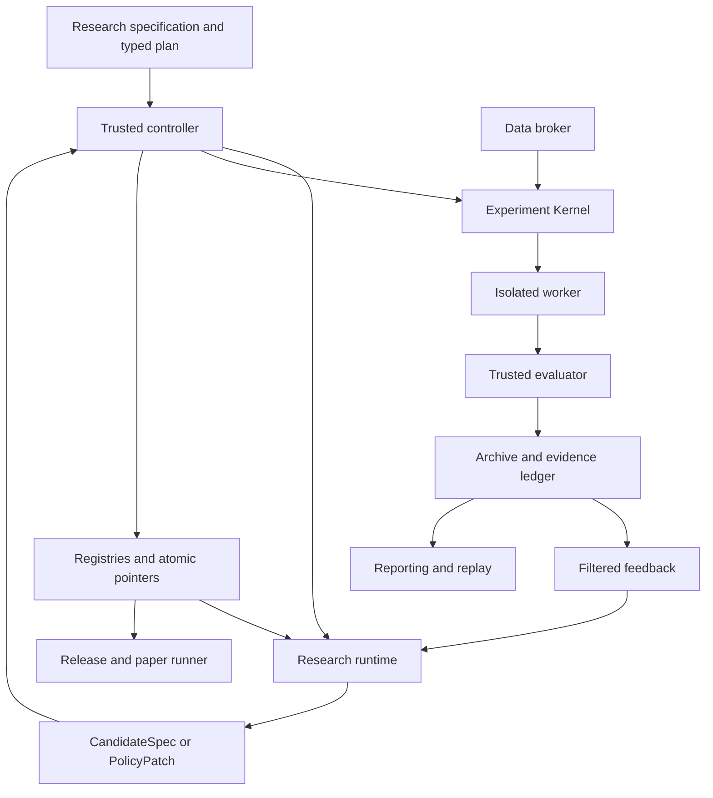
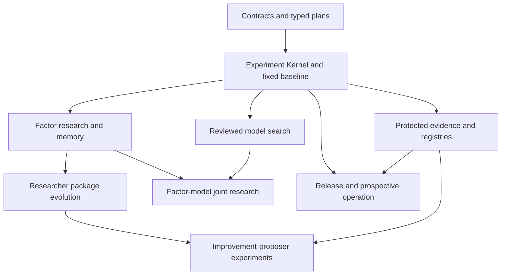

# Recursive Self-Improving Quant Research Architecture

Status: proposed architecture revision, 2026-10-24. The uploaded source is identified by SHA-256 `2f2c7683aac0b352edb40058f13a7267aefb45aea65e18de93a0b38b972c528c`. No research pipeline, statistical finding, design reapproval, or trading integration is established by this revision. Existing discussion-board approvals remain attached to their original document hashes.

Build a research system with an inner loop for factors and prediction models, an outer loop for research-program changes, and a separately evaluated extension for changes to the improvement proposer. An independently controlled evaluator determines the evidence and promotion outcome of each experiment.

The research objective is to test whether accumulated experience and changes to the research program improve outcomes at a registered research budget. Report trading performance, research productivity, and research expense separately. Higher historical returns alone do not establish recursive improvement.

Implementation follows capability dependencies. The architecture imposes no calendar schedule.

## Completion, evidence, and promotion

Maintain separate dimensions; never derive one automatically from another.

| Dimension | Representative values | Meaning |
| --- | --- | --- |
| Execution status | queued, running, completed, failed, cancelled, budget_exhausted | Whether the bound computation executed. |
| Evidence status | not_assessed, development_only, insufficient_evidence, supported, not_supported, invalid | What a specified evaluation supports. |
| Promotion decision | not_requested, pending, accept, retain_incumbent, reject, conflict | Whether an authoritative registry pointer may change. |
| Capability acceptance | not_implemented, implemented, verified | Whether a system capability satisfies its engineering contract. |

A correct comparison with a negative result may be `completed + not_supported + retain_incumbent`. It can verify that the comparison capability works. An uncertainty interval that cannot resolve the registered effect produces `insufficient_evidence`; a negative point estimate alone need not establish `not_supported`. Evidence classifications follow the frozen EvaluationPlan.

Engineering acceptance requires correct execution, access, accounting, evidence handling, and recovery. Scientific acceptance requires the registered research result. Version promotion requires the applicable independent gate. These are separate decisions.

## Scope and starting assumptions

The working frequency is daily equities; the target market remains unconfirmed. US equities are an example configuration. Choose the point-in-time universe and provider before real-market experiments. Market calendars, costs, and trading rules belong in explicit versioned specifications.

Start from a long-only portfolio, a fixed LightGBM predictor, and a reproducible factor-to-prediction-to-portfolio pipeline. Factor research, reviewed model-template research, and research-program improvement share the same Experiment Kernel. Model search is not a prerequisite for changing hypothesis prompts, retrieval rules, or proposal deduplication.

Use one machine, a Python controller, local artifact storage, SQLite metadata, and isolated worker processes or containers. Agent roles are logical responsibilities; they do not require separate always-running services or separate LLMs. Start with one experiment worker and introduce concurrency when measured throughput and resource isolation justify it.

The architecture includes factor search, model search, joint scheduling, research-program evolution, independent evaluation, reporting, and prospective paper operation. Foundation-model training, high-frequency execution, live order placement, and unrestricted infrastructure modification require their own approved capability extensions.

## Foundation and extensions

[R&D-Agent-Quant, version 2](https://arxiv.org/abs/2505.15155v2) provides a hypothesis, implementation, evaluation, and feedback workflow for factor/model research. Its implementation machinery and research scheduling are candidate components and baselines. They are not evidence for this project's performance.

Use [Qlib](https://github.com/microsoft/qlib) for suitable data, training, and backtesting components. Integrate [RD-Agent](https://github.com/microsoft/RD-Agent) through a versioned adapter. Its documented factor, model, and joint applications are useful integration references. Pin the code and dependencies actually exercised.

All search methods submit the same CandidateSpec and consume filtered feedback. RD-Agent may propose candidates or implement an approved bundle; its internal scores are not authoritative promotion results. The trusted Experiment Kernel, evaluator, registries, and evidence ledger remain project-owned boundaries.

Prove artifact and feedback exchange against a pinned adapter revision before depending on internal APIs. A small reviewed integration fork is acceptable when recorded in the environment manifest. An unavailable adapter must produce an explicit integration outcome; it must not silently substitute another method in a benchmark.

Audit the adopted execution path for signal, label, order and fill timing, position conventions, fees, and feedback partitions. Original-paper reproduction is a separate campaign with its own method and evaluator identity. Document differences between that reproduction and the project's guarded comparison. Completing every paper-reproduction investigation is not a dependency of an independently verified Experiment Kernel.

Related comparison candidates include [AutoScientist-Quant](https://arxiv.org/abs/2608.28632), which studies budget-aware quantitative research. [Hyperagents](https://arxiv.org/abs/2603.19461) motivates a separate experiment on modifying the improvement proposer. Reproduction and equal-budget comparisons must establish the relevance of either method to this project.

## System layout



The diagram groups logical components. The controller, data broker, kernel orchestration, evaluator, evidence ledger, and registries form the trusted boundary. Candidate code and editable research programs execute outside it. Initially trusted components can share one application; permissions and job-scoped data access must remain explicit.

| Component | Responsibility and boundary |
| --- | --- |
| Controller | Validate typed plans, reserve budgets, bind immutable jobs, schedule work, and own metadata writes and registry transitions. |
| Experiment Kernel | Coordinate data access, permitted training/inference, portfolio replay, trusted scoring, artifact publication, resource accounting, and failure handling through one implementation path. |
| Data catalog and broker | Identify immutable snapshots, calendars and historical membership; enforce availability times, purpose, partitions, and as-of replay. |
| Research runtime | Run a bound ResearcherPackage with a bound initial ResearchStateCheckpoint, choose permitted actions, and checkpoint derived state. |
| ResearchAdapter | Exchange CandidateSpec, permitted feedback, and state deltas with RD-Agent, a native researcher, or a comparator without privileged access. |
| Implementation/experiment worker | Compile restricted factors or execute approved model bundles within granted capabilities and limits; return validated artifacts, never authoritative self-reported scores. |
| Trusted evaluator | Validate prediction alignment and coverage, reconstruct portfolio/accounting results, compute metrics, and issue an EvaluationReport under a frozen plan. |
| Experiment archive and evidence ledger | Preserve artifacts, failures, costs, state and program lineage, result exposure, comparison budgets, and immutable event history. |
| Change proposer | Generate a PolicyPatch from permitted development evidence under a separately versioned ProposerPackage. |
| Registries | Store immutable packages, states and strategies; keep experimental references separate from accepted references; atomically apply authorized promotions. |
| Reporting and replay | Read permission-filtered projections and display executions, results, diffs, lineage, expenses, and evidence decisions. |
| Paper runner | Execute a frozen release bundle against newly available data and record hypothetical orders, fills, positions, costs, and drift. |

The kernel is shared by factor search, model search, policy comparisons, and comparators. Protected work uses the same reviewed computational semantics with a different typed plan and access grant. Worker-returned metrics may be diagnostic only; authoritative reports are reconstructed by the trusted evaluator.

Researcher acceptance and strategy release are independent. A strategy from an experimental researcher may enter its own release evaluation with complete provenance. An accepted researcher does not confer release approval on every strategy it produces.

## Research programs and runtime state

Separate immutable program definitions from accumulated experience and evolving search state.

| Object | Immutable contents |
| --- | --- |
| ResearcherPackage | Hypothesis prompts, retrieval and scheduling algorithms, tool composition, allowlisted implementation, backend configuration, interface and state-schema versions, and content digest. This replaces the ambiguous program-plus-memory meaning of PolicyVersion. |
| MemorySnapshot | Structured beliefs, successful and failed experiments, contradictions, source IDs, evidence areas, availability times, task applicability, parent snapshot and digest. |
| ResearchStateCheckpoint | MemorySnapshot reference, search/archive references, scheduler or bandit state, RNG state, continuation position, and trusted budget-ledger reference. It cannot redefine an allowance. |
| ResearchRun | ResearcherPackage, initial state checkpoint, task and plan manifests, starting strategy, budget reservation, and the resulting checkpoint sequence. |
| ProposerPackage | The separately versioned program that proposes changes to a researcher; initially frozen. |
| StrategyBundle | Factor definitions, fitted preprocessing and predictor artifacts, TrainingPolicy, PortfolioPolicy, data contract and execution environment needed to replay a selected strategy. |

Updating experience produces a new checkpoint; changing a prompt, retrieval algorithm or scheduler implementation produces a new ResearcherPackage. Ordinary posterior updates in an unchanged bandit algorithm are runtime state. A program patch that changes the bandit algorithm is a package change.

Each experiment records the package, checkpoint, and exact retrieved evidence it used. Registries may hold convenient current references, but jobs never read an unbound mutable "current memory" object during execution.

Declare compatible state-schema versions. A package change requiring migration uses a reviewed, versioned transformation, retains source provenance and access restrictions, and records its cost. If a comparison requires equal initial knowledge, each arm receives the same permitted evidence manifest and a registered equivalent state initialization. Package-specific migrations must not add inaccessible information.

A ResearchRun has an immutable launch manifest. Its resulting checkpoint sequence is derived from append-only lifecycle events and does not change run identity. The run keeps its package fixed while permitted state evolves. Continuous self-modification is represented as a sequence of linked runs with explicit package transitions. An evaluation of that whole process must freeze its update algorithm and admission rules in a trajectory plan.

## Typed plans and permissions

ResearchSpec composes versioned market/data, TrainingPolicy, PortfolioPolicy, candidate search space, objective, comparator, and budget references. The controller validates it together with a typed plan. Common data, timing, capability, accounting, and budget requirements apply to every scored experiment.

| Plan | Additional mandatory contents | Permitted output and authority |
| --- | --- | --- |
| DevelopmentPlan | Development folds, development ranking metric, candidate validity conditions, stop rules, state initialization, feedback visibility, and failure handling. | Detailed development feedback and experimental candidates. It grants no protected-data or release access. |
| ResearcherComparisonPlan | Frozen arms, matched task/start-state manifests, reserved scoring windows, task clusters, primary contrast, anchor condition, effect and uncertainty rules, inference family, and cumulative evidence budget. | Protected research-program evidence and an eligible promotion request. |
| StrategyReleasePlan | Locked StrategyBundle, independent release interval, capacity/risk/cost requirements, inference and eligibility rules, expiry, terminal accounting, and corresponding paper episode. | A release report and a separately gated release decision. |
| ProspectiveObservationPlan | Frozen strategy/version, data availability rules, purpose and visibility, observation/event requirements, simulated execution model, monitoring and expiry. | Observations labeled according to their predeclared use. An observational baseline is not a strategy release. |
| ProposerComparisonPlan | Frozen proposer arms and update algorithms, matched starting researchers/states, descendant trajectory limits, protected task manifest, scoring/selection rule, and total descendant/comparison budgets. | Evidence about the improvement mechanism under the same exposure rules as other protected comparisons. |

Evaluation tier determines required fields and capabilities; unsupported combinations fail before dispatch. Development does not require release-capacity proof, but uses explicit sizing, cost and fill assumptions and records their limitations. A release still requires its full capacity gate.

Exploratory or insufficient-evidence status describes what a result supports. It is not a switch that relaxes data access, causal timing, accounting, or budget enforcement.

## Inner loop for strategy improvement

1. Create a ResearchRun bound to a ResearcherPackage, DevelopmentPlan, starting StrategyBundle, development data snapshot and initial state checkpoint.
2. Retrieve permitted experience, recording the actual evidence IDs. Propose one hypothesis with an economic rationale, expected failure conditions and explicit differences from its parent.
3. Submit CandidateSpec through the controller. Compile factors using typed historical operators; reject future shifts, unsupported fields, excessive lookbacks, duplicate definitions and invalid shapes before training.
4. Run candidate and incumbent through the same Experiment Kernel with identical folds, preprocessing rules, seeds, costs and portfolio rules. Fit learned preprocessing only inside the designated training partitions.
5. The trusted evaluator computes predictive diagnostics and net portfolio results. Record errors and all resource consumption. Apply registered eligibility checks before ranking.
6. Update the development incumbent only under the DevelopmentPlan's rule. Persist unsuccessful candidates and a new state checkpoint. Expose only the allowed feedback.
7. Stop under the reserved candidate, token, runtime, monetary or no-progress limits. A separate StrategyReleasePlan evaluates any strategy proposed for release.

Factor research initially holds model and portfolio rules fixed. Reviewed model-template research holds the factor set fixed. Joint research starts when both paths satisfy the same candidate/execution contracts; it then records factor and model changes separately so their interactions can be studied.

Start with deterministic scheduling. When both branches work, compare fixed alternation and an adaptive scheduler under matched budgets. Scheduling rewards use development outcomes. Runtime scheduler state is checkpointed; changing its algorithm is a ResearcherPackage experiment.

Arbitrary generated model implementations require the stronger execution boundary below. Every model artifact, including fitted weights, remains distinct from the LLM researcher package.

## Outer loop for researcher improvement

A research-program experiment changes the mechanism that proposes and selects experiments. Allowed initial changes include hypothesis prompts, memory retrieval, proposal deduplication, scheduling algorithms and approved tool composition. Later implementation changes remain inside an allowlisted package.

A package cannot change evaluation rules, data manifests, risk limits, accounting, worker permissions, promotion logic or its allowance. Scheduling can allocate the granted budget; the controller's ledger remains authoritative.

### Patch, experiment and promotion protocol

1. A separately frozen ProposerPackage reads permitted development evidence and creates PolicyPatch. The patch names one expected effect, its evidence IDs, the exact base-package digest, allowed paths/fields, interface requirements and any proposed state migration.
2. The controller verifies source evidence visibility and applies the patch in a separate workspace. Validate the patch's schema, target paths, dependencies, interface, capabilities and behavior. Unapproved package changes are rejected before execution.
3. Publish a structurally valid candidate as an immutable ResearcherPackage. Development runs may explicitly use this experimental package and compatible state without changing the accepted researcher pointer. Record and compare their outputs through DevelopmentPlan.
4. Select one candidate in development before opening a protected batch. Freeze candidate, parent and initial-anchor packages, task manifests, matched starting strategies, state initialization, search spaces, backend assumptions and budgets. A backend change is a declared intervention rather than an unrecorded implementation detail.
5. On each registered task, each arm performs its bounded development search and locks one selected strategy before scoring. The task's reserved scoring interval remains inaccessible. If parent and initial are identical, reuse that arm's run without counting duplicate independent evidence.
6. Use ResearcherComparisonPlan for paired task-level comparisons. Candidate-versus-parent is the primary contrast; the predeclared improvement or non-regression condition against the initial researcher is also included in comparison and statistical budgets. Mutable memories and caches are isolated; identical starting evidence does not require identical derived states.
7. Commit the evidence batch OPENED state durably before the first protected read. Run the bound comparison, preserve failures and record exposure. A cached or retried computation retains its original evidence identity.
8. Persist the EvaluationReport and requested promotion. The controller updates the accepted package reference only when all gates pass and the expected incumbent still matches. Use a compare-and-swap transaction over the registry entry, report reference and decision event. If the incumbent changed, record conflict and rebase or compare under a new registered plan; do not transfer an obsolete verdict to a different parent.
9. An accepted-reference update affects only later runs. In-flight jobs retain their bound package and checkpoint. Rejection, insufficient evidence or execution failure leaves the accepted reference unchanged. Preserve immutable prior versions and auditable rollback targets.

Promotion reports attach to registry entries and evaluation records, not to package bytes. This prevents a package digest from changing merely because it was evaluated. Rollback is an explicit registry event; it does not erase failed experiments, expenditure or evidence exposure.

The three status dimensions remain separate throughout: a comparison can complete correctly while retaining the incumbent. The engineering capability is verified by correct handling of both acceptance and non-acceptance cases.

### Improvement-proposer experiments

Version the change proposer separately from the researcher. Initially freeze its prompts, code, backend, tools and permitted evidence. Modifying it is a separate capability: freeze the compared proposer/update algorithms, use matched starting researchers and states, run registered descendant trajectories on fresh tasks and count all descendant, repair, comparison and meta-search costs.

Predeclare trajectory length or budget, stopping, terminal scoring and any best-descendant selection on permitted development feedback. An entire continuous self-modification trajectory is a different experimental subject from one frozen candidate researcher. Its protected scoring must not become feedback for modifications within that same test episode.

A single repaired example or successful child does not establish a better improvement mechanism. Evaluation, permissions, budgets and completion criteria remain outside editable packages.


### Researcher comparison scoring and failures

The following task-level rules directly govern frozen-researcher comparisons. ProposerComparisonPlan separately preregisters descendant selection, development-failure aggregation and terminal trajectory scoring. A failed exploratory descendant is not automatically a failed proposer comparison; it remains in the trajectory and cost ledger. Once a terminal strategy is locked for protected scoring, the same no-loss-erasure, data-integrity and accounting requirements apply.

The primary comparison aggregates paired task-level scores at a common research budget, using the registered primary metric and default equal task weights fixed before evaluation. Report experiment success rate, expense, wall time, and implementation failure rate alongside it. Count proposal, repair, comparison, baseline and meta-search costs separately and in total system economics. Trading costs enter net portfolio returns; research expense remains a separate ledger unless an explicit capital-and-amortization model defines an economic conversion.

Each task has a frozen fallback strategy prevalidated using permitted development data and synthetic fixtures, never by inspecting the reserved scoring window. No eligible development candidate, development code failure or budget exhaustion selects this fallback with a no_valid_candidate outcome; lock that selection before OPENED and retain the task. A benchmark-identical fallback cannot provide a valid active information ratio when tracking error is zero.

Once protected scoring begins, do not replace a selected strategy's realized return path with fallback returns because it failed, breached risk limits or received an undefined score. In the initial protocol, a candidate-specific protected scoring failure, unmet minimum observations or hard risk breach blocks that researcher's promotion; retain the failure and all costs rather than dropping the task. A preselected fallback or reference arm that cannot be scored makes the comparison insufficient_evidence under registered rules, not a candidate win. Data or benchmark corruption follows a predeclared integrity rule applied identically to every arm; if too little valid evidence remains, promotion is prohibited. Any future finite failure utility must be preregistered as a research-task score, explicitly distinct from an executable portfolio return.

Research task separation must include memory provenance: an agent cannot inherit summaries, factors, or cached models derived from that task's reserved scoring period. Seeds provide information about execution variability; they do not create independent market histories. Group overlapping tasks or shared market shocks into registered evidence clusters. Paired resampling uses common date blocks across assets and preserves temporal and cross-sectional dependence; overlapping tasks and multiple seeds must not inflate the count of independent market observations.

## Evaluation and evidence boundaries

### Distinct uses of data

| Data area | Purpose | Who receives its results |
| --- | --- | --- |
| Development folds | Repeated factor, model, and policy debugging | Researchers receive detailed development feedback. |
| Reserved researcher comparison tasks | Compare frozen research-policy versions | The promotion authority receives scores; exposure and decisions are recorded. |
| Reserved strategy release interval | Evaluate a frozen selected strategy for release | The release authority receives the report after the candidate is locked. |
| Future paper observations | Assess prospective behavior after release | Monitoring receives results; any subsequent research use is recorded. |

Different reserved purposes and evaluation batches have distinct manifests and non-overlapping scoring windows. Arms within one comparison deliberately share the same task windows; correlated tasks inside that batch follow the registered clustering rules. A comparison task may expose its training and development data to the researcher; its scoring interval remains inaccessible. The final strategy release interval must not already have influenced policy selection.

Reusing a test after seeing its results makes it development evidence. Even an accept or reject decision conveys information. Register a finite evaluation-query budget, consume each reserved batch, and record its exposure. When fresh evidence is exhausted, continue development or collect future data; do not claim a newly independent validation by renaming a partition.

### Protected evidence lifecycle and cumulative comparisons

The trusted controller owns an evidence ledger with states AVAILABLE -> RESERVED -> OPENED -> COMPLETED -> RETIRED. RESERVED binds the evidence program, purpose, comparison plan, task manifest, candidate/parent/initial hashes, data/evaluator/environment hashes, seed list, and budgets. Commit OPENED durably before issuing any protected-data access token or starting a scoring read.

OPENED irreversibly consumes the batch, including on partial output, accept/reject exposure, timeout or crash. A failed attempt is recorded as FAILED_CONSUMED; attempt status is separate from the irreversible exposure flag. A bounded technical retry may finish only the identical bound computation, with no changed code, parameters, seeds, tasks or best-attempt selection. Record all retry costs; do not grant another comparison allowance. Verify hashes on cached partial results and publish completed reports atomically. Retire a cancelled RESERVED batch in the initial implementation. If recovery cannot establish whether exposure occurred, treat the batch as consumed.

An evidence_program_id owns the cumulative protected-comparison limit, generation limit, minimum economic effect, statistical error budget and stopping rule. Campaign restarts, new candidate names and new program labels do not erase exposure or selection history. A genuinely new objective retains links to prior evidence and must register its additional budget before evaluation. Baseline and anchor comparisons also count.

Register the finite comparison family and its inference method before opening evidence. Conservative finite-test correction or preallocated error budgets are admissible only when the underlying inference is justified for the temporal dependence and adaptive selection involved. Neither new windows nor a named correction automatically validates inference. Insufficient history, uncalibrated inference or exhausted evidence produces development_only (exploratory) or insufficient_evidence status, never confirmed improvement. Continue development or collect prospectively reserved data without relabeling old evidence.

Historical data may overlap an LLM's pretraining knowledge. Record provider, model identifier, declared knowledge cutoff when available, and retrieval sources. Hiding dates from a prompt is not proof of uncontaminated evaluation. Forward paper observations provide a stronger prospective check.

### Point in time and execution rules

Maintain event time, available-at time, instrument identity, historical universe membership, corporate actions, and data revision identifiers. Features at a decision time may use only information available then. Include delisted instruments where applicable and fit imputers, scalers, and selectors only on training data.

For the initial daily design, compute signals after the close of session t and model execution at the open of session t+1, with explicit costs and fill assumptions. A configurable horizon H defines returns from the open of t+1 to the open of t+1+H. Start with H=1. If reliable open prices or executable liquidity are unavailable, change the registered execution convention before testing.

Use chronological walk-forward folds. Exclude training observations whose label intervals overlap a validation or scoring interval. Any additional gap or embargo must follow the label horizon, publication delay, and split construction. Only mature labels available at the replay time may enter training.

The initial TrainingPolicy fits once at each fold's origin using its designated training partition and holds weights fixed throughout that fold. Folds have separate model artifacts. A release episode uses one model fitted before its protected release interval, and the identical weights continue into its corresponding paper episode; no silent refit is allowed at the paper boundary. Register maximum model age and episode duration, then suspend on expiry. Later scheduled refitting requires a new approved TrainingPolicy specifying windows, frequency, label maturity, trigger time and failure fallback, verified by identical historical replay before release.

Trading costs include commissions, spread, slippage, and market impact assumptions appropriate to the selected market. Portfolio construction fixes cash handling, position limits, turnover rules, participation limits, missing predictions, suspensions, and corporate actions. A signal metric such as rank IC is a diagnostic, not a replacement for executable net performance.

Register initial capital, currency, order sizing, maximum positions and weights, gross exposure, execution session/venue, participation basis, impact model, partial fills and unfilled-order handling. Orders formed after t's close may use only then-available information for their quantities. Realized t+1 open prices or auction volume may determine fills and accounting, never retroactively determine submitted quantities. Fix cash reservation and sell-proceeds availability rules in the portfolio policy.

Register terminal_position_policy, valuation_policy, liquidation_costs and accounting_end_rule before an episode starts. At expiry, suspension or a scoring boundary, preserve existing positions and accrued profit or loss: specify whether inventory remains marked to market or exits at the next eligible trading event. Include terminal inventory valuation and all applicable exit costs; stopping new orders must not erase unrealized losses. Historical replay and paper operation follow the same rules, including suspended or delisted holdings. Any required liquidation tail belongs to the bound evidence interval; unavailable prices produce the registered incomplete-evaluation outcome rather than a costless fictional exit.

Daily OHLCV alone does not establish opening-auction capacity. A documented conservative proxy may support exploratory results, with capacity_status=unverified. Such results cannot pass an executable-strategy release gate. An observational baseline recorder can still operate with that limitation labeled; it does not become an approved release. Cost and capital-scale sensitivity must accompany capacity claims.

### Selection and promotion

Before an operation, validate its typed plan and transitive ResearchSpec. DevelopmentPlan registers its metric, benchmark, annualization, fold aggregation, validity/sample conditions, costs, risk assumptions, budgets and invalid-outcome policy. Protected comparison plans additionally register task aggregation, minimum effect, uncertainty/inference method, task clusters and cumulative evidence budget. StrategyReleasePlan additionally registers the capacity, robustness and operational requirements for release. Missing fields block only operations requiring those fields. Thresholds and inference choices are frozen before observing the candidates or protected outcomes to which they apply.

For the proposed daily equity baseline, rank eligible development candidates by median fold net information ratio relative to a fixed investable benchmark. Define the benchmark and annualization convention in the specification. Treat near-zero tracking error, non-finite ratios and insufficient observations or trades as ineligible rather than assigning favorable values; register numerical tolerances before testing. Record fold dispersion, net returns, drawdown, turnover, exposure, and rank IC.

Release requires valid data provenance and timing, reproducible artifacts, acceptable risk and liquidity, robustness to predefined cost stress, and the registered independent comparison. Use paired block-based uncertainty estimates on aligned returns. Preserve the full trial inventory, including policy searches. Multiple-testing diagnostics such as the deflated Sharpe ratio can supplement evaluation when their assumptions apply; they do not make adaptive reuse of a test independent. [Bailey and Lopez de Prado](https://www.davidhbailey.com/dhbpapers/deflated-sharpe.pdf)

An evaluator change creates a new evaluation version. Compare candidate and incumbent again under that version; do not combine incompatible scores in one leaderboard. Corrections require an ordinary reviewed infrastructure change outside the self-improvement loop.

## Records and persistence

Use typed, versioned contracts at component boundaries. Large datasets, predictions, orders, returns and logs live in artifact files; SQLite holds metadata, lineage, ledger entries and references. Contract definitions have checked examples and explicit schema versions.

| Record | Required contents |
| --- | --- |
| ResearchSpec | Versioned market/data, universe, decision/fill conventions, label horizon, search space, objective/comparator, TrainingPolicy, PortfolioPolicy and budget references. Its digest transitively binds all calculation-relevant settings. |
| Typed EvaluationPlan | Tier-specific partitions, metrics, validity/aggregation, comparison or release rules, visibility, integrity/failure handling, inference/evidence budget and immutable plan digest. |
| CandidateSpec | Hypothesis, parent StrategyBundle, proposing package/run/checkpoint, factor AST or approved model specification, parameters, declared data dependencies and candidate digest. |
| ExperimentJob | Campaign/run/task/experiment/attempt IDs, purpose, candidate/spec/plan/data/fold/environment digests, package/checkpoint provenance, seed, reserved budget and capability grant. |
| PredictionArtifact | Instrument ID, timezone-aware decision timestamp, prediction kind/value, fold, model artifact digest, data-availability contract and coverage manifest. |
| ExperimentResult | Execution status, published artifact references/digests, categorized error, usage reconciliation, completion events and integrity checks. Agent-reported metrics are non-authoritative diagnostics. |
| ExperimentRecord | Bound job, attempts, exact LLM requests/responses or approved redacted references, retrieved evidence IDs, source versions, lifecycle events and consumed resources. |
| EvaluationReport | Tier, subjects and baselines, authoritative metrics and aligned returns, checks, uncertainty, evidence status, outcome reasons, exposure and applicable promotion recommendation. |
| ResearcherPackage | Immutable prompt/code/retrieval/scheduling/tool/backend definitions, interface and state-schema versions, parent package, originating patch/proposer, and digest. No mutable memory or pending report is embedded in its identity. |
| MemorySnapshot / ResearchStateCheckpoint | Source and derived evidence manifests, visibility and as-of scope, belief/search state, parent references and digests; checkpoints reference the trusted budget ledger. |
| ResearchRun | Bound program, initial checkpoint, task/plan/start-strategy manifest, budget and checkpoint sequence. |
| PolicyPatch | Exact base digest, allowlisted patch, expected effect, evidence IDs, interface constraints and any versioned state migration. |
| ProposerPackage | Parent program, code/prompt/backend/tool digests, permitted evidence policy and patch lineage; initially frozen. |
| TrainingPolicy / PortfolioPolicy | Fit timing/windows/frequency, label maturity, age/expiry/fallback; sizing, cash, fills, fees, actions, risk behavior, terminal valuation and liquidation accounting. |
| EvidenceProgram / EvaluationBatch | Cumulative comparison/inference budgets, registered tasks/clusters, stopping rules, bound subjects and computation, irreversible exposure, attempts and retries. |
| PromotionRequest / RegistryEntry | Subject, parent/anchor, expected incumbent reference, comparison/release plan and report, decision/status, transaction ID and auditable pointer history. |
| ReleaseRecord | Frozen StrategyBundle, weights/preprocessing, market-data specification, environment, research/proposer provenance, release report, capacity status, expiry, paper episode and rollback target. |

### Executable interface contracts

The following signatures specify the intended interfaces; they do not claim that these modules are implemented.

```python
ResearchAdapter.propose(context: ProposalContext) -> CandidateSpec
ResearchAdapter.observe(
    context: ObservationContext, feedback: DevelopmentFeedback
) -> StateDelta
ExperimentKernel.run(job: ExperimentJob) -> ExperimentResult
Evaluator.evaluate(
    job: ExperimentJob, result: ExperimentResult
) -> EvaluationReport
ChangeProposer.propose(context: ChangeContext) -> PolicyPatch
Registry.promote(request: PromotionRequest) -> PromotionDecision
```

Contexts contain immutable references, permitted views and bounded tool handles. StateDelta is validated and committed by the controller into a new checkpoint. An adapter cannot directly write metadata, update an accepted pointer or grant itself data access.

PredictionArtifact has a registered primary key: instrument identity, decision timestamp, prediction kind and fold. Specify timezone, calendar, sorting, duplicate rejection, missing predictions and expected coverage. Label timestamps and execution timestamps are aligned by the trusted data/evaluation adapter; a worker cannot silently relabel its prediction index.

Distinguish input/schema errors, invalid candidates, timeout/resource exhaustion, worker failure, missing observations and data-integrity failure. These categories determine retry eligibility and evidence outcomes under the bound plan. They must not silently become zero-return successes or remove losing tasks.

Publish artifacts atomically before recording completion. The controller is the sole metadata writer. Workers receive job-specific directories and return validated artifacts. Append lifecycle events and derive current state from them; protect snapshots with backups and access controls. SQLite is an operational record, not a tamper-proof proof system.

Keep research summaries linked to source experiments and permitted data areas. Start with structured SQL retrieval and text search; evaluate embeddings through the same retrieval task contract before adoption. Preserve contradictory and failed observations alongside positive ones.

Researchers and proposers receive filtered views, not direct archive access. Protected labels and detailed reports use separate permissions; possession of an artifact reference does not grant access. Record which metrics and decisions every run and package has observed.

## Run identity, replay and caching

Use separate identifiers for a research run, an experiment, an attempt and a deterministic computation. Retries are new attempts under the same experiment; failures are never overwritten.

An experiment-result cache key binds CandidateSpec/StrategyBundle, ResearchSpec digest, EvaluationPlan digest, exact data/fold manifests, TrainingPolicy and preprocessing/model versions, PortfolioPolicy, costs, benchmark, accounting, evaluator, environment and seed. Any transitive reference must be immutable and included in digest resolution. A changed fee, fill, terminal-valuation or benchmark rule cannot reuse an incompatible score.

A researcher-run reuse key additionally binds ResearcherPackage, initial ResearchStateCheckpoint, task/start-strategy manifest, exact permitted feedback, backend configuration, search scope and budget/charging rules. Do not assume that a remote LLM reproduces the same response from a seed. Persist permitted requests and responses for exact artifact replay; a fresh sampled response is a new attempt with recorded expense.

Authorize data and evidence purpose before reading a cache entry. Cache results retain their access classification, original data/plan provenance and exposure identity. A protected cache entry cannot leak labels, scores, artifacts or future-derived models into development. Cache reuse does not create fresh independent evidence or reset a comparison allowance. Reuse within the identical bound computation shares its original exposure and retry accounting. A new statistical query needs its own registered allowance and eligible evidence; previously exposed data supports only an appropriately labeled reuse or development analysis.

Shared immutable preprocessing caches require a registered charging policy. Report actual infrastructure expense and logical work separately; maintain the same policy across compared arms. A hash match proves identity under the chosen serialization, not economic validity or absence of data leakage.

## Execution isolation and recovery

The first factor interface is a restricted expression language evaluated by trusted operators. This reduces the opportunity for a generated factor to inspect future rows or change the experiment machinery.

For later generated Python, use unprivileged workers with read-only inputs, no host or container-engine sockets, no provider or broker credentials, no unrestricted network, and limits on CPU, memory, GPU, disk, processes, and time. The trusted controller performs LLM requests through a bounded gateway. External data acquisition runs separately from candidate execution.

Load candidate model bundles only inside isolated workers. The trusted scoring process consumes schema-validated predictions and metadata; it must not deserialize arbitrary candidate objects or execute code embedded in returned artifacts.

Reserved evaluation must not hand arbitrary candidate code a complete future feature panel: later price rows can reveal earlier outcomes even without a label column. A trusted replay adapter supplies only the current as-of batch and permitted history, persists allowed state, and checks that predictions are invariant when future data changes. Training receives only the designated historical training partition. Restricted expressions and reviewed model templates remain preferable until this boundary is verified.

Use states such as proposed, validated, queued, running, completed, validation_rejected, failed, cancelled, and budget_exhausted. Track promotion separately from execution success. A worker crash or timeout records a terminal attempt; the controller may retry within the remaining budget. Reserve budget before dispatch and reconcile actual usage afterward. Do not launch work when the remaining allowance cannot cover its configured maximum.

Stop scheduling at cancellation or budget exhaustion, terminate remaining workers according to policy, and retain completed artifacts. Restart from committed events and artifact hashes. A failed experiment cannot change the active strategy or researcher pointer.

## Paper trading and release boundary

After a strategy passes release evaluation, freeze the complete release bundle, including TrainingPolicy, PortfolioPolicy, market-data specification and environment. Apply the same weights and expiry rules specified above for the initial release/paper episode. The paper runner ingests newly available data and records decision timestamps, submitted orders, simulated fills, costs, positions and deviations from historical assumptions.

After the Experiment Kernel's data and accounting checks, a separate baseline recorder may begin collecting forward observations while research continues. Register its version, access policy and development-versus-protected purpose before collection. Developer-visible observations cannot later become independent protected evidence. This recorder is an observation activity, not a shortcut through the strategy release gate.

Monitor data freshness, feature drift, invalid predictions, exposure, drawdown, and execution assumptions. Breached operational or risk limits suspend the paper candidate and preserve the last accepted version. Research continues in a separate workspace and cannot hot-patch the paper runner.

A future live broker adapter would be a separate project stage, with its own risk controller and deployment authorization. Researcher promotion, strategy promotion, and permission to trade capital are separate decisions.

## Reporting, explanation and observation

Provide a reporting surface over permission-filtered read models. It displays:

- experiment execution, failures, retries and consumed resources;
- factor/model candidates, predictions, net returns and diagnostic metrics;
- ResearcherPackage, MemorySnapshot and checkpoint lineage;
- policy patches, supporting experiment IDs and the exact versions used by later runs;
- development comparisons, protected evidence status and promotion decisions as distinct fields;
- release bundles, paper observations, drift and suspension events;
- actual expense and logical work, with research costs separated from trading costs.

Reports link every numerical claim to an authoritative EvaluationReport and its artifacts. Generated explanations cite permitted experiments and distinguish a proposed mechanism from an observed relationship. A convincing narrative is not an additional scoring input unless a predeclared experiment explicitly evaluates it.

Users can replay a run by its bound artifacts and event sequence. Mark historical replay, newly executed research, prospective observations and simulated fills explicitly. Show rejected versions and insufficient evidence alongside successful outcomes.

If the UI starts, cancels or requests promotion of a run, it submits a command to the controller. It cannot mutate ledger rows, evaluator settings or registry pointers directly. Read permissions follow evaluation purpose; displaying a protected score is an exposure event for the authorized recipient.

## Repository organization

The following is a proposed layout. Modules are created as their capabilities are implemented; this document provides no claim of runnable commands.

```text
docs/architecture.md
src/quant_rsi/
    contracts/             # Specs, typed plans, jobs, artifacts, patches
    controller/            # Commands, orchestration, budgets, recovery
    kernel/                # Common experiment execution and accounting
    data/                  # Catalog, availability rules, partition broker
    adapters/              # Qlib, RD-Agent, native and comparison methods
    research/              # Packages, hypotheses, state, retrieval
    execution/             # Factor compiler, workers, resource limits
    evaluation/            # Prediction validation, replay, metrics, reports
    evidence/              # Protected batches, exposure, inference budgets
    registry/              # Immutable versions, CAS promotion, lineage
    meta/                  # Researcher and proposer patch generation
    reporting/             # Read models, dashboard, explanations, replay
    paper/                 # Prospective simulation and monitoring
tests/
    contracts/
    unit/
    integration/
    fixtures/
configs/
    markets/
    development/
    researcher_comparisons/
    strategy_releases/
    prospective_observations/
    proposer_comparisons/
examples/
```

Keep datasets and run artifacts outside version control in configured storage. Apply separate protected-data permissions. Initialize Git before source implementation so package patches, evaluator changes and release bundles have reviewable revisions. The integration adapter may be replaced without changing the Experiment Kernel contracts or declaring incomparable runs equivalent.

## Capability implementation plan

Dependencies reflect what a capability needs to execute and be verified. A favorable financial finding is not an implementation dependency.



Protected evidence infrastructure can be implemented alongside research methods. A concrete researcher promotion requires both a frozen candidate and a valid comparison plan. Strategy-release capability accepts any eligible frozen strategy with full provenance; it does not wait for a researcher-improvement hypothesis to succeed. Joint research is an optional producer of release candidates, not a universal release prerequisite.

| Capability | Dependencies | Deliverable | Engineering acceptance |
| --- | --- | --- | --- |
| C0. Contracts and specifications | Resolved architectural interfaces | Versioned schemas, typed-plan validation, digests, immutable artifact references and decision records. | Contract fixtures accept valid cases and reject incomplete or mismatched tier/capability combinations. |
| C1. Experiment Kernel and baseline | C0 and selected market/data for market runs | Data broker, fixed LightGBM pipeline, portfolio/accounting, authoritative evaluator, storage, budgets and replay. | Synthetic and independent hand-calculated fixtures reconcile timing, cash, positions, costs and failures; an adopted baseline is reproducible from bound artifacts. |
| C2. Factor research and state | C1 | Restricted factors, proposal/observation adapter, structured memory and checkpointed search. | A complete propose-execute-observe cycle respects budgets and permissions; malformed and failed candidates remain visible; exact used versions and evidence are recoverable. |
| C3. Reviewed model search | C1 and an approved fixed factor set | Reviewed model templates, comparable training and model artifact handling. | Template changes execute through the kernel with frozen factor inputs; prediction alignment, invalid outputs, reproducibility and costs are verified. |
| C4. Researcher package evolution | C2, C0 patch contracts | Frozen proposer, PolicyPatch validation, experimental package runs, state compatibility and lineage. | Valid patches affect subsequent bound runs; invalid patches and base-package mismatches fail; experimental package/state recovery is exercised while accepted pointers remain protected. |
| C5. Protected evidence and promotion | C1, C0 comparison contracts | Comparison runner, exposure ledger, inference-program accounting and atomic registry decisions. | Positive, negative, inconclusive and invalid fixtures exercise correct outcomes; accepted-pointer CAS conflicts, rollback events, crash/retry/exposure rules and budget persistence are verified. Actual research findings are reported separately. |
| C6. Joint factor/model research | C2 and C3 | Fixed and adaptive scheduling with declared reward, state and budget semantics. | Both branches use the same kernel; controlled factor-only/model-only/joint campaigns can execute without score or accounting drift. |
| C7. Release and prospective operation | C1 and C5; an eligible frozen candidate for actual release | Release runner, full bundle, observational recorder, paper runner, monitoring and expiry. | Causal sizing, unchanged approved weights, simulated fills, terminal inventory, suspension and rollback match replay. Actual release still requires the candidate's full independent gate. |
| C8. Improvement-proposer evolution | C4 and C5 | Frozen proposer-comparison algorithms, matched starting states and descendant-trajectory runner. | Every descendant, selection and cost is traceable; protected results cannot steer within-test modifications; registered acceptance and rejection cases behave correctly. |

Reporting is a cross-cutting capability: define its read contracts with C0, add experiment views with C1/C2, state and patch views with C4, evidence views with C5, and prospective views with C7. It must not wait for all research branches to complete.

A baseline recorder may collect prospective observations after C1 when its purpose and access are registered. This does not grant researcher promotion, executable release or live-trading authorization.

Original-paper reproduction is an independent campaign through the same interfaces or a separately identified original workflow. Its findings determine comparator eligibility and documented deviations; they do not replace local kernel verification.

### Verification evidence

The meaningful verification suite includes synthetic future-value leakage and overlapping-label cases, historical universe and publication-lag fixtures, hand-calculated cost and position accounting, artifact replay, forbidden-access attempts, future-data perturbation invariance, worker crash recovery, duplicate-job handling, budget enforcement, and failed-promotion rollback. Independent small accounting fixtures must cover cash and position conservation, sale-proceeds timing, fees/taxes, partial fills and cancellations, splits/delistings, missing quotes, calendars and trade units. Compare the Qlib adapter against those expected transactions rather than its own aggregate metrics. Future-data perturbation must preserve current orders as well as predictions; immature labels must not enter training. Verify crash points before and after OPENED commits, no best-retry selection, evidence-budget persistence and bundle expiry. Include protected-period failure after an initial loss to verify that fallback cannot overwrite the return path, and episode-end loss positions, costly liquidation and unavailable terminal prices to verify complete accounting. These are planned tests, not claims of completed verification.

Map these checks to the capability that owns the behavior. Kernel fixtures do not require a successful market hypothesis; protected-ledger tests use controlled positive, negative and inconclusive cases. A verified implementation may correctly retain every incumbent in a real campaign.

## Research experiments and acceptance

Separate the hypotheses being tested. The following conditions are building blocks; a campaign preregisters its chosen contrasts, budgets and inference procedure.

| Condition | Research program and state | Primary role |
| --- | --- | --- |
| Fixed investment baseline | A frozen strategy with no candidate search. | Investment reference and accounting check; do not treat it as an equal-cost search algorithm. |
| No-feedback search | Frozen ResearcherPackage; independent proposal context without accumulated experimental feedback. | Establish the result of search at the registered candidate and total-cost budgets. |
| Memory learning | Frozen ResearcherPackage; experience accumulates and is retrieved under its unchanged algorithm. | Compare with no-feedback search to estimate the contribution of the registered feedback/memory intervention. |
| Research-program improvement | A frozen candidate ResearcherPackage compared with its parent and initial anchor from matched permitted state. | Estimate the contribution of changing the research program under controlled initial knowledge. |
| Adaptive-system trajectory | A frozen self-modification/update algorithm that may produce a registered sequence of packages and states. | Evaluate the complete adaptive process, including meta-search and all descendant costs. |

No-feedback versus memory learning does not isolate every component of retrieval or reasoning. Research-program comparison controls the initial evidence manifest; a comparison allowing different accumulated knowledge is a separate end-to-end system question. Select further ablations only when they identify a stated mechanism.

Use the same data access, task universe, initial candidate, available operators/templates, backend configuration where applicable and computation-accounting rules for an isolated algorithmic comparison. A model/backend change or wider search space is a declared multi-component intervention and is reported separately.

Report matched candidate-evaluation counts and matched total research expenditure as separate comparison views. Include proposal, repairs, rejected candidates, memory updates, training, meta-search, protected evaluation and reference-arm expenses. Do not hide improvement-search cost when presenting deployment-time researcher efficiency.

The primary researcher outcome is the registered paired task-level performance at a common budget. Also report useful-candidate yield, invalid/duplicate rate, wall time, inference/training expense and stability. Strategy diagnostics include rank IC, net returns, benchmark-relative performance, drawdown, turnover and exposure. Retain the original temporal/cross-sectional dependence and uncertainty requirements.

Non-LLM search, a pinned RD-Agent workflow and the frozen initial researcher are stage-level benchmark candidates. Add reproducible newer methods in a preregistered future batch. Broader comparators need not run for every package patch; every formal promotion still satisfies its registered parent and anchor rules.

Publish unsuccessful and inconclusive campaigns. A research method can be implemented correctly and fail its hypothesis. SOTA, transferable improvement and investment-performance claims require their own stated task, market, period, budget, comparator set and independent evidence.

## Decisions and design acceptance

The architecture fixes responsibilities and contracts. Campaign values remain unapproved until entered and validated. A document revision does not choose a market, allocate capital or authorize live deployment.

| Responsible role | Decision before the relevant activity | Missing prerequisite blocks |
| --- | --- | --- |
| Research owner | Market/provider, historical universe, objective, benchmark, search space, research spending and relevant capital/risk assumptions. | The corresponding real-data DevelopmentPlan or later activity; schema and synthetic-fixture work may proceed. |
| Evaluation maintainer | Data manifests, folds/label maturity, validity and fallback rules; protected task clusters, effect/inference/stopping rules and cumulative evidence program when required. | The scoped scored operation or protected comparison requiring those fields. |
| Execution maintainer | TrainingPolicy, PortfolioPolicy, causal sizing/cash/fills, environment/capabilities, cost/impact assumptions and expiry. | Candidate execution or release according to its typed plan. |
| Integration maintainer | Pinned library/framework versions, adapter contract, reproducibility differences and comparator eligibility. | Use of that adapter/comparator, without blocking independent implementations of the shared kernel. |
| Release operator | Frozen bundle, independent release evidence, capacity, observation purpose/access, monitoring, event requirements and rollback. | Approved paper release; live capital requires a separate later authorization. |

Mandatory fields are validated by operation type before dispatch, including budget reservation and evidence grants. Explicitly declared unsupported configurations fail; they are not filled with retrospective assumptions.

Design acceptance requires resolved contract ambiguities, consistent diagrams/rules and an identified decision owner for every unresolved campaign parameter. Preserve the existing joint-review process: the quant manager and quant executor record CONFIRMED_COMPLETE against the same final architecture SHA-256 in discussion_boards. This proposed revision does not claim those records exist for its new bytes. Substantive edits require the corresponding new sign-off.

Implementation capability verification, research findings, researcher promotion, strategy release and permission to trade capital retain separate evidence and decisions.

## Revision map

| Original area | Revision |
| --- | --- |
| Success criterion and stage gates | Separate execution, evidence, promotion and engineering capability acceptance. |
| Linear implementation sequence | Replace calendar-independent stage ordering with capability dependencies; factor, model and policy work use a shared kernel. |
| PolicyVersion and memory | Introduce immutable ResearcherPackage, MemorySnapshot, ResearchStateCheckpoint and bound ResearchRun. |
| Campaign prerequisites | Use typed Development, ResearcherComparison, StrategyRelease, ProspectiveObservation and ProposerComparison plans. |
| Component descriptions | Specify adapter, job, prediction, result, state-delta, patch and promotion contracts. |
| Policy promotion | Bind exact parent/version, validate patches, preserve in-flight versions and atomically compare-and-swap accepted references. |
| Cache and replay | Bind transitive specifications and state; enforce access before cache lookup; preserve evidence identity and cost accounting. |
| Empirical comparisons | Distinguish search, memory learning, program changes and full self-modifying trajectories. |
| Reporting | Add permission-filtered run views, diffs, lineage, explanations and replay. |
| Existing integrity rules | Retain point-in-time data, protected exposure, cumulative comparisons, failure accounting, worker isolation and release gates. |
