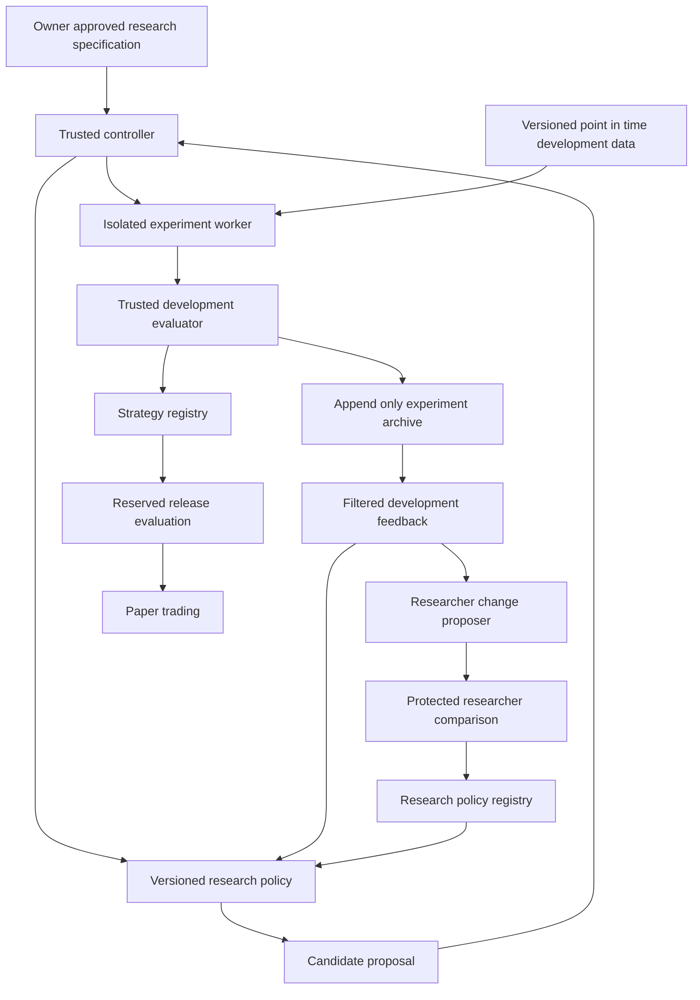

# Recursive Self Improving Quant Research Architecture

Status: design specification, 2026-10-23. No research pipeline or trading integration is implemented yet. Joint design approval is recorded in discussion_boards against this file's SHA-256; implementation and empirical acceptance remain separate.

Build a research system with two nested improvement loops. The inner loop improves factors and prediction models. The outer loop proposes and evaluates changes to the researcher itself. An independently controlled evaluator determines whether either kind of change deserves promotion.

The first success criterion is evidence that accumulated feedback produces better research outcomes under a fixed budget. Higher historical returns alone do not establish recursive improvement.

## Scope and starting assumptions

The working frequency is daily equities; the target market remains unconfirmed. US equities are an example configuration, not an owner-approved market choice. Start with a long-only portfolio, a fixed LightGBM predictor, and factor search. Choose the point-in-time universe and data provider before running experiments. Market calendars, costs, and trading rules belong in an explicit market configuration.

Use one machine, a Python controller, local artifact storage, SQLite metadata, and isolated worker processes or containers. Agent roles are logical responsibilities; they do not require separate always-running services or separate LLMs. Start with one experiment worker. Add concurrency only when measured throughput requires it.

Model search and researcher modification follow demonstrated factor-search reliability. Live order placement, high-frequency trading, foundation-model training, and unrestricted modification of infrastructure are outside the first implementation.

## Foundation and extensions

The paper supplies a specification, hypothesis synthesis, implementation, validation, and analysis loop. It accumulates experiment experience and uses contextual Thompson sampling to choose between factor and model work. Its Co-STEER component supports implementation through execution feedback. These are the starting mechanisms, rather than evidence of indefinite capability growth. [R&D-Agent-Quant, version 2](https://arxiv.org/abs/2505.15155v2)

Reuse suitable components from [RD-Agent](https://github.com/microsoft/RD-Agent), whose documented applications include factor, model, and joint optimization. Use [Qlib](https://github.com/microsoft/qlib) for its data, training, and backtesting components. Pin tested revisions and dependencies when implementing.

Our additions are independent evaluation, strict artifact lineage, controlled researcher changes, and explicit management of repeated testing. RD-Agent's own experiment scores are development feedback; our evaluator owns authoritative promotion results. Prove that a pinned RD-Agent revision can exchange candidate artifacts and feedback through an adapter before committing to its internal APIs. If needed, use a small reviewed integration fork.

Stage 0 must audit the pinned code and configuration for signal, label, order and fill timing, long-only versus long-short positions, fees, and every feedback partition. The paper's section 3 and appendices C.4.2/D.1 contain conflicting descriptions of these details; this is a reproducibility question, not proof of an implementation defect. Label an original reproduction separately from a guarded comparison. If the original workflow exposes reported test results during search, document the adapter changes needed for our comparison instead of calling the two runs identical.

Related comparison candidates include budget-aware search in [AutoScientist-Quant](https://arxiv.org/abs/2608.28632). [Hyperagents](https://arxiv.org/abs/2603.19461) motivates a later experiment in modifying the improvement proposer itself. These works inform benchmarks and design; neither establishes this project's performance or guarantees sustained improvement.

## System layout



The controller, data broker, evaluator, and registries form the trusted boundary. Candidate code and research policies execute outside that boundary. The diagram shows logical components; the first implementation can keep trusted components in one application, with separate permissions and workers for candidate execution and protected evaluation.

| Component | Responsibility and interface |
| --- | --- |
| Controller | Validate specifications, allocate budgets, schedule work, manage state transitions, and invoke evaluation. A policy requests actions; it cannot execute privileged operations directly. |
| Data catalog and broker | Identify immutable data snapshots and calendars; enforce availability timestamps, historical membership, and partition access. Return only the data permitted for a job. |
| Research policy | Retrieve permitted experience, choose a direction, propose a falsifiable hypothesis, and produce a candidate specification. |
| Implementation worker | Compile a factor expression or build an approved model bundle; execute checks within resource and access limits. |
| Evaluator | Train through trusted adapters, calculate predictions and portfolio results, apply fixed checks, and issue structured verdicts. |
| Experiment archive | Preserve hypotheses, artifacts, failures, costs, metrics, parent relationships, and exposure to evaluation results. |
| Change proposer | Under a separately versioned, initially frozen proposer, produce a patch to allowed research-policy files and an explanation of the expected improvement. |
| Registries | Store immutable strategy and researcher versions; change active-version pointers only after the appropriate gates pass. |
| Paper runner | Execute a frozen strategy against newly arriving data, track hypothetical orders and fills, and report operational and performance drift. |

## Inner loop for strategy improvement

1. Load the approved research specification, development data snapshot, incumbent strategy, and permitted memory checkpoint.
2. Propose one hypothesis with an economic rationale, expected failure conditions, and an explicit change from its parent. Initially change factors while holding the model and portfolio rules fixed.
3. Compile the proposal into a typed factor expression using a restricted set of historical operators. Reject future shifts, unsupported fields, excessive lookbacks, duplicate definitions, and invalid shapes before training.
4. Run the candidate and incumbent under identical folds, preprocessing, seeds, costs, and portfolio rules. All learned preprocessing is fitted inside each training fold.
5. Record predictive diagnostics, net portfolio performance, failure reasons, and resource consumption. Apply eligibility checks before ranking candidates.
6. Update the development incumbent only when the specified comparison passes. Store unsuccessful candidates as well as successful ones. Produce bounded feedback for the next proposal.
7. Stop when the experiment, token, runtime, or monetary limit is reached, or a predefined no-progress condition holds. A separate release process decides whether the selected strategy advances to paper trading.

Start with deterministic scheduling. After both factor and model search work, compare fixed alternation with the paper's contextual bandit under the same budget. Its reward must use development outcomes, never reserved release results.

Model search initially selects among reviewed templates and parameters. Arbitrary generated model implementations require the stronger execution boundary described below. Every new model is tested with a frozen factor set before joint changes are considered.

## Outer loop for researcher improvement

Version a research policy as a package containing prompts, retrieval rules, scheduling policy, approved tool composition, and eventually selected researcher implementation code. The LLM backend and configuration are part of the version. Changing a prompt alone can be an experiment, but promotion requires measured benefit.

Allowed changes initially cover hypothesis prompts, memory retrieval, proposal deduplication, and scheduling. The policy cannot change evaluation rules, partition manifests, risk limits, accounting, worker permissions, promotion logic, or its own budget. Later code changes stay within an allowlisted policy package and run through the same bounded tool interface.

Version the change proposer separately from the research policy. Initially freeze its prompts, code, backend, tools, and permitted evidence. Modifying the proposer itself is a later research stage: compare fixed-length descendant-researcher trajectories from matched starting states on fresh tasks under the same total budget, including all descendant costs. A single repaired example or successful child does not establish a better improvement mechanism. Evaluation, permissions, and completion criteria remain outside the editable packages.

Each proposed change follows this protocol:

1. Derive a change from development evidence and record one expected effect, such as fewer invalid factors or more useful experiments per unit cost.
2. Run structural and behavioral checks against the policy interface. Reject attempts to expand permissions or write outside allowed artifacts.
3. Select and freeze one candidate researcher in development before opening a protected batch. Compare it with its parent and the frozen initial researcher on the same registered tasks, each with training context, development folds, and a reserved scoring interval. Lock one selected strategy per task and arm before scoring. When parent and initial are identical, reuse one run rather than counting it as independent evidence twice.
4. Give all arms the same initial strategy, permitted source-experience manifest, tasks, backend configuration, search space, and budget limits. Derived memories follow each arm's algorithm; mutable memories and caches are isolated. Count failures, repairs, and LLM calls. Shared immutable preprocessing caches require a fixed charging rule, with actual expense and logical work reported separately.
5. Commit the protected batch's OPENED state before granting access, following the exposure protocol below. Use registered paired comparisons, with candidate-versus-parent as the primary improvement test and the registered improvement or non-regression condition against the initial researcher. Both enter the comparison and statistical budgets.
6. Record the result and exposure; update the active researcher pointer only when all criteria pass. Otherwise retain the incumbent and report rejection or insufficient evidence. Preserve prior versions for rollback.

The primary comparison aggregates paired task-level scores at a common research budget, using the registered primary metric and default equal task weights fixed before evaluation. Report experiment success rate, expense, wall time, and implementation failure rate alongside it. Count proposal, repair, comparison, baseline and meta-search costs separately and in total system economics. Trading costs enter net portfolio returns; research expense remains a separate ledger unless an explicit capital-and-amortization model defines an economic conversion.

Each task has a frozen fallback strategy prevalidated using permitted development data and synthetic fixtures, never by inspecting the reserved scoring window. No eligible development candidate, development code failure or budget exhaustion selects this fallback with a no_valid_candidate outcome; lock that selection before OPENED and retain the task. A benchmark-identical fallback cannot provide a valid active information ratio when tracking error is zero.

Once protected scoring begins, do not replace a selected strategy's realized return path with fallback returns because it failed, breached risk limits or received an undefined score. In the initial protocol, a candidate-specific protected scoring failure, unmet minimum observations or hard risk breach blocks that researcher's promotion; retain the failure and all costs rather than dropping the task. A preselected fallback or reference arm that cannot be scored makes the comparison insufficient_evidence under registered rules, not a candidate win. Data or benchmark corruption follows a predeclared integrity rule applied identically to every arm; if too little valid evidence remains, promotion is prohibited. Any future finite failure utility must be preregistered as a research-task score, explicitly distinct from an executable portfolio return.

Research task separation must include memory provenance: an agent cannot inherit summaries, factors, or cached models derived from that task's reserved scoring period. Seeds provide information about execution variability; they do not create independent market histories. Group overlapping tasks or shared market shocks into registered evidence clusters. Paired resampling uses common date blocks across assets and preserves temporal and cross-sectional dependence; overlapping tasks and multiple seeds must not inflate the count of independent market observations.

## Evaluation and evidence boundaries

### Distinct uses of data

| Data area | Purpose | Who receives its results |
| --- | --- | --- |
| Development folds | Repeated factor, model, and policy debugging | Researchers receive detailed development feedback. |
| Reserved researcher comparison tasks | Compare frozen research-policy versions | The promotion authority receives scores; exposure and decisions are recorded. |
| Reserved strategy release interval | Evaluate a frozen selected strategy for release | The release authority receives the report after the candidate is locked. |
| Future paper observations | Assess prospective behavior after release | Monitoring receives results; any subsequent research use is recorded. |

Different reserved purposes and evaluation batches have distinct manifests and non-overlapping scoring windows. Arms within one comparison deliberately share the same task windows; correlated tasks inside that batch follow the registered clustering rules. A comparison task may expose its training and development data to the researcher; its scoring interval remains inaccessible. The final strategy release interval must not already have influenced policy selection.

Reusing a test after seeing its results makes it development evidence. Even an accept or reject decision conveys information. Register a finite evaluation-query budget, consume each reserved batch, and record its exposure. When fresh evidence is exhausted, continue development or collect future data; do not claim a newly independent validation by renaming a partition.

### Protected evidence lifecycle and cumulative comparisons

The trusted controller owns an evidence ledger with states AVAILABLE -> RESERVED -> OPENED -> COMPLETED -> RETIRED. RESERVED binds the evidence program, purpose, comparison plan, task manifest, candidate/parent/initial hashes, data/evaluator/environment hashes, seed list, and budgets. Commit OPENED durably before issuing any protected-data access token or starting a scoring read.

OPENED irreversibly consumes the batch, including on partial output, accept/reject exposure, timeout or crash. A failed attempt is recorded as FAILED_CONSUMED; attempt status is separate from the irreversible exposure flag. A bounded technical retry may finish only the identical bound computation, with no changed code, parameters, seeds, tasks or best-attempt selection. Record all retry costs; do not grant another comparison allowance. Verify hashes on cached partial results and publish completed reports atomically. Retire a cancelled RESERVED batch in the initial implementation. If recovery cannot establish whether exposure occurred, treat the batch as consumed.

An evidence_program_id owns the cumulative protected-comparison limit, generation limit, minimum economic effect, statistical error budget and stopping rule. Campaign restarts, new candidate names and new program labels do not erase exposure or selection history. A genuinely new objective retains links to prior evidence and must register its additional budget before evaluation. Baseline and anchor comparisons also count.

Register the finite comparison family and its inference method before opening evidence. Conservative finite-test correction or preallocated error budgets are admissible only when the underlying inference is justified for the temporal dependence and adaptive selection involved. Neither new windows nor a named correction automatically validates inference. Insufficient history, uncalibrated inference or exhausted evidence produces exploratory or insufficient_evidence status, never confirmed improvement. Continue development or collect prospectively reserved data without relabeling old evidence.

Historical data may overlap an LLM's pretraining knowledge. Record provider, model identifier, declared knowledge cutoff when available, and retrieval sources. Hiding dates from a prompt is not proof of uncontaminated evaluation. Forward paper observations provide a stronger prospective check.

### Point in time and execution rules

Maintain event time, available-at time, instrument identity, historical universe membership, corporate actions, and data revision identifiers. Features at a decision time may use only information available then. Include delisted instruments where applicable and fit imputers, scalers, and selectors only on training data.

For the initial daily design, compute signals after the close of session t and model execution at the open of session t+1, with explicit costs and fill assumptions. A configurable horizon H defines returns from the open of t+1 to the open of t+1+H. Start with H=1. If reliable open prices or executable liquidity are unavailable, change the registered execution convention before testing.

Use chronological walk-forward folds. Exclude training observations whose label intervals overlap a validation or scoring interval. Any additional gap or embargo must follow the label horizon, publication delay, and split construction. Only mature labels available at the replay time may enter training.

The initial TrainingPolicy fits once at each fold's origin using its designated training partition and holds weights fixed throughout that fold. Folds have separate model artifacts. A release episode uses one model fitted before its protected release interval, and the identical weights continue into its corresponding paper episode; no silent refit is allowed at the paper boundary. Register maximum model age and episode duration, then suspend on expiry. Later scheduled refitting requires a new approved TrainingPolicy specifying windows, frequency, label maturity, trigger time and failure fallback, verified by identical historical replay before release.

Trading costs include commissions, spread, slippage, and market impact assumptions appropriate to the selected market. Portfolio construction fixes cash handling, position limits, turnover rules, participation limits, missing predictions, suspensions, and corporate actions. A signal metric such as rank IC is a diagnostic, not a replacement for executable net performance.

Register initial capital, currency, order sizing, maximum positions and weights, gross exposure, execution session/venue, participation basis, impact model, partial fills and unfilled-order handling. Orders formed after t's close may use only then-available information for their quantities. Realized t+1 open prices or auction volume may determine fills and accounting, never retroactively determine submitted quantities. Fix cash reservation and sell-proceeds availability rules in the portfolio policy.

Register terminal_position_policy, valuation_policy, liquidation_costs and accounting_end_rule before an episode starts. At expiry, suspension or a scoring boundary, preserve existing positions and accrued profit or loss: specify whether inventory remains marked to market or exits at the next eligible trading event. Include terminal inventory valuation and all applicable exit costs; stopping new orders must not erase unrealized losses. Historical replay and paper operation follow the same rules, including suspended or delisted holdings. Any required liquidation tail belongs to the bound evidence interval; unavailable prices produce the registered incomplete-evaluation outcome rather than a costless fictional exit.

Daily OHLCV alone does not establish opening-auction capacity. A documented conservative proxy may support exploratory results, with capacity_status=unverified. Such results cannot pass an executable-strategy release gate. An observational baseline recorder can still operate with that limitation labeled; it does not become an approved release. Cost and capital-scale sensitivity must accompany capacity claims.

### Selection and promotion

Before a campaign, register primary_metric, benchmark, annualization, development_aggregation, task_aggregation, min_sessions, min_trades, min_folds, minimum_effect, uncertainty_method, risk/capacity_limits, cost_scenarios, and invalid_outcome_policy. Unset mandatory fields prevent a campaign from running. Thresholds belong to the experiment specification and cannot be chosen after observing candidates.

For the proposed daily equity baseline, rank eligible development candidates by median fold net information ratio relative to a fixed investable benchmark. Define the benchmark and annualization convention in the specification. Treat near-zero tracking error, non-finite ratios and insufficient observations or trades as ineligible rather than assigning favorable values; register numerical tolerances before testing. Record fold dispersion, net returns, drawdown, turnover, exposure, and rank IC.

Release requires valid data provenance and timing, reproducible artifacts, acceptable risk and liquidity, robustness to predefined cost stress, and the registered independent comparison. Use paired block-based uncertainty estimates on aligned returns. Preserve the full trial inventory, including policy searches. Multiple-testing diagnostics such as the deflated Sharpe ratio can supplement evaluation when their assumptions apply; they do not make adaptive reuse of a test independent. [Bailey and Lopez de Prado](https://www.davidhbailey.com/dhbpapers/deflated-sharpe.pdf)

An evaluator change creates a new evaluation version. Compare candidate and incumbent again under that version; do not combine incompatible scores in one leaderboard. Corrections require an ordinary reviewed infrastructure change outside the self-improvement loop.

## Records and persistence

Use typed, versioned records at component boundaries. Large datasets, predictions, and logs live in artifact files; SQLite holds metadata and references. Store parent links for both strategy and policy ancestry.

| Record | Required contents |
| --- | --- |
| ResearchSpec | Market and universe, point-in-time snapshot, decision and fill timing, label horizon, folds, primary metric and aggregations, minimum samples, fallback, capital/capacity and risk settings, costs, budgets, evidence program, policy versions, and evaluator version. |
| CandidateSpec | Hypothesis, parent strategy, policy version, factor AST or model bundle digest, parameters, and declared data dependencies. |
| ExperimentRecord | Experiment and attempt identifiers, specification digest, code and environment versions, seeds, LLM provenance, artifact references, lifecycle events, and consumed resources. |
| EvaluationReport | Evaluation tier, candidate and baseline identifiers, fold metrics, aligned prediction and return references, checks, uncertainty, verdict, and exposure record. |
| PolicyVersion | Parent and initial policy, proposer version, patch digest, prompt/backend/tool versions, source and derived memory manifests, permitted capabilities, and comparison report. |
| ProposerVersion | Parent proposer, code/prompt/backend/tool hashes, permitted evidence, and generated-patch lineage; initially frozen. |
| TrainingPolicy / PortfolioPolicy | Fit origin and frequency, training windows, label maturity, age/expiry and fallback; sizing, cash, fills, fees, corporate actions, risk behavior, terminal positions, valuation and liquidation accounting. |
| EvidenceProgram / EvaluationBatch | Cumulative comparison and statistical budgets, registered tasks and clusters, stopping rules, bound artifacts, irreversible exposure state, attempts and retries. |
| ReleaseRecord | Frozen factors, weights, preprocessing, TrainingPolicy, PortfolioPolicy, market-data specification and environment; policy/proposer provenance, evaluation report, capacity status, expiry, paper status and rollback target. |

Use content hashes for immutable inputs and artifacts. A run identity includes candidate, data, folds, evaluator, environment, and seed, so caching cannot silently reuse a score after any of them changes. Record retries as new attempts under the same experiment; never overwrite failures.

The trusted controller is the sole metadata writer. Workers receive job-specific directories and return validated artifacts. Publish artifacts atomically before marking a job complete. Append lifecycle events and derive current status from them; protect snapshots with backups and access controls. This is operational traceability, not a claim that SQLite is tamper-proof.

Keep research summaries linked to source experiments and their permitted data areas. Start with structured SQL retrieval and text search. Add embeddings only if they improve retrieval on a measured task.

Researchers and the change proposer receive filtered views, not direct archive access. Store protected labels and detailed reserved-evaluation reports in separately permissioned storage; archive references do not grant permission to retrieve them. Record which metrics and decisions each policy version has seen.

## Execution isolation and recovery

The first factor interface is a restricted expression language evaluated by trusted operators. This reduces the opportunity for a generated factor to inspect future rows or change the experiment machinery.

For later generated Python, use unprivileged workers with read-only inputs, no host or container-engine sockets, no provider or broker credentials, no unrestricted network, and limits on CPU, memory, GPU, disk, processes, and time. The trusted controller performs LLM requests through a bounded gateway. External data acquisition runs separately from candidate execution.

Load candidate model bundles only inside isolated workers. The trusted scoring process consumes schema-validated predictions and metadata; it must not deserialize arbitrary candidate objects or execute code embedded in returned artifacts.

Reserved evaluation must not hand arbitrary candidate code a complete future feature panel: later price rows can reveal earlier outcomes even without a label column. A trusted replay adapter supplies only the current as-of batch and permitted history, persists allowed state, and checks that predictions are invariant when future data changes. Training receives only the designated historical training partition. Restricted expressions and reviewed model templates remain preferable until this boundary is verified.

Use states such as proposed, validated, queued, running, completed, rejected, failed, cancelled, and budget_exhausted. Track promotion separately from execution success. A worker crash or timeout records a terminal attempt; the controller may retry within the remaining budget. Reserve budget before dispatch and reconcile actual usage afterward. Do not launch work when the remaining allowance cannot cover its configured maximum.

Stop scheduling at cancellation or budget exhaustion, terminate remaining workers according to policy, and retain completed artifacts. Restart from committed events and artifact hashes. A failed experiment cannot change the active strategy or researcher pointer.

## Paper trading and release boundary

After a strategy passes release evaluation, freeze the complete release bundle, including TrainingPolicy, PortfolioPolicy, market-data specification and environment. Apply the same weights and expiry rules specified above for the initial release/paper episode. The paper runner ingests newly available data and records decision timestamps, submitted orders, simulated fills, costs, positions and deviations from historical assumptions.

After Stage 0 data and accounting checks, a separate baseline recorder may begin collecting forward observations while research continues. Register its version, access policy and development-versus-protected purpose before collection. Developer-visible observations cannot later become independent protected evidence. This recorder is an observation activity, not a shortcut through the strategy release gate.

Monitor data freshness, feature drift, invalid predictions, exposure, drawdown, and execution assumptions. Breached operational or risk limits suspend the paper candidate and preserve the last accepted version. Research continues in a separate workspace and cannot hot-patch the paper runner.

A future live broker adapter would be a separate project stage, with its own risk controller and deployment authorization. Researcher promotion, strategy promotion, and permission to trade capital are separate decisions.

## Repository organization

The following is the proposed implementation layout. Create modules as their milestones require them; the current artifacts are design and discussion documents, not an implemented pipeline.

```text
docs/architecture.md
src/quant_rsi/
    schemas.py
    controller.py
    data/                 # Catalog, availability rules, and partition broker
    research/             # Policy, hypotheses, memory, and RD-Agent adapter
    execution/            # Factor compiler, workers, and resource limits
    evaluation/           # Qlib adapter, replay, metrics, and promotion rules
    registry/             # Experiment records, artifacts, and version pointers
    meta/                 # Policy patches and controlled researcher comparisons
    paper/                # Prospective simulation and monitoring
tests/
    unit/
    integration/
    fixtures/
configs/                  # Reviewed market and research specifications
examples/                 # Small reproducible workflows
```

Keep market datasets and run artifacts in a configured location outside version control. Partition protected data into separately permissioned storage. Initialize Git before implementation so policy patches, evaluator changes, and release bundles have reviewable source revisions. This document does not establish runnable commands.

## Implementation sequence and acceptance evidence

| Stage | Deliverable | Evidence required to advance |
| --- | --- | --- |
| 0. Data and baseline | Choose market/provider, define ResearchSpec, pin Qlib and RD-Agent, audit the paper reproduction and feedback partitions, prove the adapter, and reproduce a fixed LightGBM baseline. | Point-in-time provenance; independently reconciled orders/cash/fills/fees; correct feedback access; replayable artifacts; no future-data access. |
| 1. Factor research | Restricted factor expressions, controller, isolated execution, experiment archive, and development feedback. | Recover cleanly from failure; respect budgets; compare feedback-driven search with a fixed baseline and the same search without accumulated feedback. |
| 2. Model research | Reviewed model templates and factor/model scheduling. | Factor-only, model-only, and joint ablations under equal budgets; independent strategy release evaluation. |
| 3. Researcher improvement | Allowlisted policy changes, a frozen proposer, and reserved comparison tasks. | Registered candidate-versus-parent improvement and initial-anchor condition pass; all comparisons and costs counted; crash/retry exposure, rollback and evidence exhaustion behave as specified. |
| 4. Prospective operation | Approved frozen strategy paper runner and monitoring; the observational baseline recorder may start after Stage 0. | Required capacity evidence, predeclared observation period and event count, matching training/execution policies, expiry enforcement, reconciled orders/fills, and no unresolved operational failures. |

The meaningful verification suite includes synthetic future-value leakage and overlapping-label cases, historical universe and publication-lag fixtures, hand-calculated cost and position accounting, artifact replay, forbidden-access attempts, future-data perturbation invariance, worker crash recovery, duplicate-job handling, budget enforcement, and failed-promotion rollback. Independent small accounting fixtures must cover cash and position conservation, sale-proceeds timing, fees/taxes, partial fills and cancellations, splits/delistings, missing quotes, calendars and trade units. Compare the Qlib adapter against those expected transactions rather than its own aggregate metrics. Future-data perturbation must preserve current orders as well as predictions; immature labels must not enter training. Verify crash points before and after OPENED commits, no best-retry selection, evidence-budget persistence and bundle expiry. Include protected-period failure after an initial loss to verify that fallback cannot overwrite the return path, and episode-end loss positions, costly liquidation and unavailable terminal prices to verify complete accounting. These are planned tests, not claims of completed verification.

For the first empirical milestone, compare three conditions: a fixed baseline without search, the same proposal system without accumulated experiment feedback, and the feedback-driven researcher. Match budgets for the two search conditions and keep the evaluation protocol fixed. This isolates the contribution of memory and iteration before adding researcher code changes.

Stage-level benchmark campaigns additionally compare non-LLM search, a pinned RD-Agent workflow and the frozen initial researcher; include reproducible newer methods in a preregistered future batch. Match inputs, search scope, backend where applicable, execution/cost assumptions and budget accounting. If methods require different search spaces, report that comparison separately rather than imply an isolated algorithmic advantage. These broader baselines need not run for every small policy promotion. Register the comparison suite before seeing results, and report unsuccessful campaigns. SOTA claims must identify their market, period, budget, comparator set and independent evidence.

## Decisions before implementation

The architecture fixes responsibilities and checks, while campaign values remain unapproved until entered and validated. Do not infer owner approval of a market, capital amount or live deployment from this document.

| Responsible role | Required decision before the relevant activity | Missing prerequisite blocks |
| --- | --- | --- |
| Research owner | Market/provider, historical universe, benchmark, primary objective, minimum economic effect, capital, risk and capacity settings, research spending limits. | Campaign start and executable release, as applicable. |
| Evaluation maintainer | Data manifests and availability, folds and label maturity, valid fallback, minimum samples, evidence program and task clusters, statistical procedure, comparison limits, stopping and integrity rules. | Scored experiments or protected comparisons requiring those fields. |
| Execution maintainer | TrainingPolicy and PortfolioPolicy, causal sizing, cash/fill semantics, environment and sandbox, cost/impact models, model age and expiry. | Candidate execution or release until the corresponding checks pass. |
| Release operator | Frozen bundle, prospective purpose/access rules, observation duration/event count, monitoring and rollback target. | Approved paper release; live capital requires a separate later authorization. |

Missing mandatory fields fail validation before dispatch, including retry and comparison budget reservation. Independent implementation of schemas, synthetic fixtures, the controller, storage and access checks may proceed.

Design acceptance requires resolved critical ambiguities, consistent diagrams and rules, and a named gate for each unresolved campaign parameter. The quant manager and quant executor each record CONFIRMED_COMPLETE against the same architecture SHA-256 in discussion_boards. Substantive edits invalidate that sign-off until both reconfirm. This records architectural agreement; implementation tests, profitable performance, SOTA and sustained recursive improvement require their own evidence.
