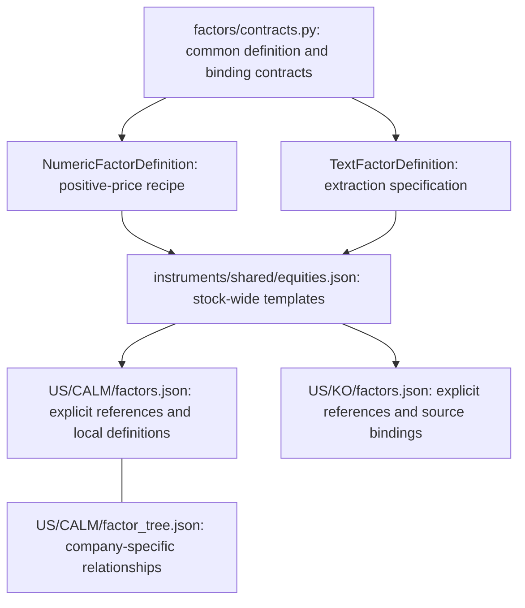

# Shared factor definitions and instrument bindings

Factor definitions are organized by **scope**, independently of whether their input
is numeric or textual. Shared processing contracts live in the engine; stock-wide
templates live outside individual stock directories; company-specific definitions,
source bindings and explanatory relationships live inside the stock directory.



## What each layer owns

| Layer | Responsibility | Example |
| --- | --- | --- |
| Common Python contracts | Define numeric/text variants and explicit source bindings | `NumericFactorDefinition`, `TextFactorDefinition` |
| Shared stock catalog | Reusable definitions without ticker-specific sources | Five-session stock momentum, issuer-event extraction specification |
| Instrument configuration | Select shared definitions; own local definitions and source bindings | CALM binds stock momentum to CALM, KO binds the same definition to KO |
| Instrument factor tree | Describe company-specific hypotheses and relationships | CALM's egg-price, supply and demand branches |

The shared definition describes a recipe, not a value shared by every stock and not
evidence that it predicts every stock. CALM's egg-price hypothesis belongs to CALM;
its arithmetic reuses the same numeric recipe contract. Nothing imports CALM's
local definitions into KO. Catalogs cannot import instruments or other catalogs,
and local definitions cannot silently override shared definitions.

An industry catalog can be added under `instruments/shared/` when several instruments
actually share definitions. Instruments must explicitly name it in `catalogs`.
Catalogs are composed, not automatically inherited; there is no precedence-based
override, directory scanning, or global mutable registry. A new parameterization
gets its own definition ID. Relationship graphs remain instrument-owned.

## Validate and inspect the resolved configuration

Use the [Python 3.12/Linux installation](../README.md#installation-and-usage).
From the repository root:

```bash
quant-rsi factors validate US CALM
quant-rsi factors validate US KO
# From another working directory, specify the checked-out configuration root:
quant-rsi factors validate US KO --root /absolute/path/to/instruments
```

The command reads `shared/<catalog>.json` and `<market>/<symbol>/factors.json`.
It reports each selected definition, its shared/instrument owner and its explicit
source binding. It rejects malformed numeric/text variants, duplicate IDs,
shadowing, unknown references, mismatched directory identities and paths escaping
the instruments root. Definitions not selected by a binding are not applied.
JSON output is detached from the parsed models; validation does not write files,
collect data, reserve budget or train. The API is
`quant_rsi.factors.catalog.resolve_instrument_factors(root, market, instrument)`.

## Execution boundary

Resolved output says `status: specification_only` and `runnable: false`.
Source IDs in these examples are proposed bindings, not registered providers,
data snapshots or proof of historical availability. Validation checks structure
and reference resolution, not whether a source exists or has usable observations.
The CLI does not interpret or validate CALM's separate factor-tree relationships.

Numeric definitions embed the existing `FactorSpec` recipe and therefore support
only `momentum` / `mean_return` with windows 1–30 on positive price series. They do
not imply support for arbitrary numerical financial fields. A window still needs
an explicit observation calendar; a five-observation egg-price window must not
silently be treated as five stock trading sessions. Existing research/forecast
plans, recipes, serialization and worker dispatch remain unchanged. These factor
configs are not accepted as development plans or automatically used by forecasts.

Text definitions preserve an extraction instruction and named output fields.
No extractor, model, prompt execution, numeric encoding or training path is added.
Before executing text-derived factors, bind extractor/model versions, structured
output types and units, source evidence, availability clocks, missingness handling,
aggregation rules and the existing cumulative budget. Reuse `SignalEvent` for
news provenance; an extraction result is not evidence of predictive usefulness.
Unknown extraction results must not silently become zero.

The existing [CALM tree](calm_factor_discovery_example.md) remains a specification;
CALM's exchange is still unsupported by the current forecast adapter. This PR does
not complete factor-tree execution, point-in-time admission, recursive feature
discovery or the broader architecture proposals in issues #8 and #24.

## Validation

```bash
pytest -q tests/test_factor_layers.py tests/test_model_and_plan.py tests/test_forecast_inputs.py
ruff check src tests
ruff format --check src tests
```

Adding Python sources changes the runtime fingerprint. Historical runs must keep
using their original source environment, as described in [version control](version_control.md).
