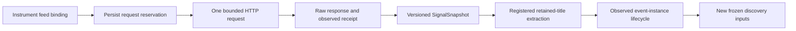

# Prospective issuer-news observations

The next executable part of [RFC #28](https://github.com/natureofnature/Quant_RSI/issues/28) and [RFC #31](https://github.com/natureofnature/Quant_RSI/issues/31) connects a registered public feed to the existing retained-title extractor and event-factor lifecycle. It performs **RSS polling**, not provider-side search, web crawling or full-article retrieval.

The first binding is KO's official investor-relations feed, linked from its [press releases page](https://investors.coca-colacompany.com/news-events/press-releases). The URL, issuer, allowed item hosts and event template live in [KO's configuration](../instruments/US/KO/news_feed.json). Shared collection, parsing, evidence and recovery code contains no issuer-specific title rules. The existing reviewed KO title grammar remains unchanged; it recognizes a narrow literal title form and does not classify every earnings headline or infer business facts.

## Run explicitly

Use the README's Linux/Python 3.12 environment. Review [the example plan](../examples/ko_news_collection.json), especially its campaign identity and UTC start boundary. Initialization requires a past boundary and freezes the source configuration and runtime. It sends no network request.

```bash
mkdir -p runs/ko-news
export QUANT_RSI_WORKSPACE="$(pwd)/runs/ko-news"
quant-rsi news-collect init examples/ko_news_collection.json

# Sends one bounded HTTPS request to the registered official RSS URL.
quant-rsi news-collect poll ko-news-observed-001 --request-id poll-001

# Uses only the sealed response; no network request or model fit.
quant-rsi news-collect process ko-news-observed-001 \
  --request-id poll-001 --news-campaign-id ko-news-research-001

quant-rsi news-collect status ko-news-observed-001
quant-rsi news-collect replay ko-news-observed-001
```

For a later observation, explicitly use `poll-002`, then process that ID with the **same** news campaign. No scheduler or unattended collection service is installed. Repeating a sealed poll ID returns its original result, even if the provider has changed. A new ID consumes another reservation; it is never an automatic retry.

The default plan allows eight HTTP attempts, each reserving 256 KiB and 128 item slots before dispatch. Failed, empty, interrupted and rejected responses keep their reservations. The byte ceiling covers response bytes read; derived JSON/artifact storage adds overhead. Each request has a 15-second transport timeout, rejects redirects and performs no retries. A body reaching its byte cap, too many items, malformed XML or conflicting duplicate identities yields unknown coverage and retained evidence. Initialization, processing and replay do not authorize fitting or trading.

## Data and recovery contract



- State uses the original workspace authority, Journal and content-addressed artifact store under `.quant_rsi/news_collections/<campaign_id>`. Output paths cannot renew budgets. A missing manifest or journal fails closed.
- Requests record dispatch and receipt clocks separately from publication metadata. Date-only and unknown publication times remain so. A freshly downloaded historical announcement is first observed **now**, never at its publication date.
- The provider's item GUID (or link fallback) gives stable document identity. Changed title/summary/publication metadata creates a new revision; unchanged items retain their original revision and first observation. A vanished feed entry is not a retraction. Distinct document IDs are not automatically merged as one real-world event.
- A response checkpoint survives interruption before parsing. Recovery derives the result from the already retained bytes and original receipt clock. If interruption left only a dispatch reservation, retrying that ID seals `interrupted_request_outcome_unknown` without another HTTP call. Resolve that pending ID before issuing a new one.
- Sealed polls retain the complete earlier observation history. Later corrections do not rewrite earlier snapshots. Read-only status/replay verifies retained artifacts without collection or extraction. New dispatch and processing require the registered source/runtime; preserve that worktree/environment when upgrading.
- All processed polls share one explicitly bound downstream news campaign. Changing poll IDs cannot create new extraction or comparison allowances. Search/extraction and fit budgets remain owned by their existing ledgers.
- Raw RSS bytes, response receipts, source bindings and title payloads remain available through transitive evidence references in extracted results and event-instance snapshots. Removing referenced raw evidence causes processing/replay failure.

## Use event instances in discovery

`process` returns `news_result_ref`, `observation_ref` and per-event outcomes. The collection report gives the artifact directory. The existing APIs consume these artifacts:

```python
from pathlib import Path
from quant_rsi.core.artifacts import ArtifactStore, canonical, digest
from quant_rsi.factors.lifecycle import snapshot, attach_instance
from quant_rsi.market.news_collection import inspect, process

report = inspect("ko-news-observed-001")
store = ArtifactStore(Path(report["artifact_directory"]))
processed = process("ko-news-observed-001", "poll-001", "ko-news-research-001")
news_result = store.json(processed["news_result_ref"])
active = next(
    (row for row in processed["outcomes"]
     if row["status"] == "active_for_registered_research"),
    None,
)
if active is None:
    raise ValueError("No admitted event instance in this observation")
instance = snapshot(active["instance_id"])
envelope = attach_instance(envelope, instance)  # Existing registered ForecastInputs.
event_leaf = {
    "name": "issuer_release", "role": "event",
    "instance_ref": digest(canonical(instance)),
}
```

Include that leaf alongside numeric bindings in a new [discovery plan](factor_discovery.md). An exact positive title may instantiate an observed indicator even when the feed's overall coverage is incomplete. A valid negative revision retires that indicator; an unreliable revision suspends it with a missing value. The template's seven-day TTL and lifecycle evidence remain explicit. This is feature admission, not a predictive claim.

**RSS coverage always remains partial.** Repeated polls do not prove complete intervals. Consequently the aggregate news-count feature remains missing for RSS-only coverage; missing articles are not zero events. Frozen event-instance features have their separate registered lifecycle semantics. Newly observed evidence cannot fill old training rows, so initial discovery can legitimately stop with insufficient evidence. Collecting a response does not establish a prospective predictive study.

## Validation and remaining scope

`pytest -q tests/test_news_collection.py` uses invented RSS fixtures and mocked HTTP transport. It covers the collection/extraction/lifecycle path, raw-evidence closure, revisions, unknown coverage, explicit budgets, interruption recovery and CLI replay. The implementation work does not execute live research collection, paid APIs or fitting.

Provider-side search, full-text/semantic extraction, generic retraction resolution, independently adequate coverage, automated scheduling, proposer-policy evolution and prospective predictive validation remain separate work. No broader RFC is closed by this adapter.
